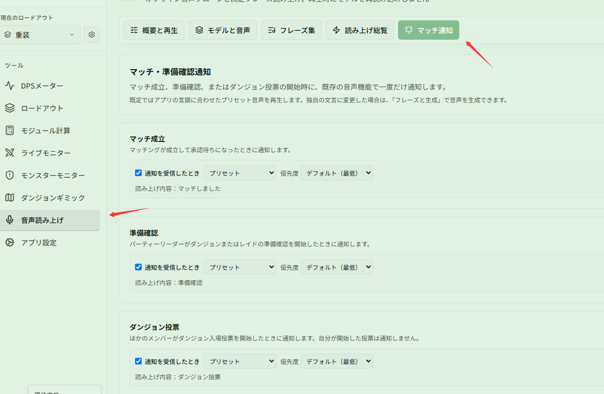

# 放置でマッチング待ちしているときにマッチ成立を聞き逃さない

関連ページ：[再生と通知](../playback.md)

**シナリオ**：ダンジョンのマッチング待ちをしながら、画面を切り替えて動画を見ています。マッチ成立、リーダーによる準備確認、ダンジョン突入の投票のときに音声で知らせてもらい、確認を逃さないようにしたいとします。

## ステップ 1：音声をオンにする

**{{ui:routes.tools.voice}} → {{ui:voice.tabs.overview}}** で **{{ui:voice.overview.enabled}}** をオンにし、ゲームから画面を切り替えていてもはっきり聞こえる音量にします。

## ステップ 2：プリセット音声通知をオンにする

**{{ui:voice.tabs.alerts}}** を開き、次の 3 つをそれぞれオンにします。

- **{{ui:voice.alerts.matchReady.title}}**
- **{{ui:voice.alerts.readyCheck.title}}**
- **{{ui:voice.alerts.teamVote.title}}**

**プリセット音声は設定不要ですぐ利用可能**：アプリにあらかじめ音声が組み込まれているため、プルダウンを「プリセット」にしておけば、音声モデルのダウンロードや生成を行うことなくそのまま利用できます。

## ステップ 3：文言のカスタマイズ（任意）

「早く戻って確認して」のように独自の目立つ文言に変更したい場合は、プルダウンを「カスタムテキスト」に切り替えて入力します。カスタムテキストを使用する場合は、**{{ui:voice.tabs.bindings}}** で **{{ui:voice.bindings.generateMissing}}** をクリックして音声を生成してください。

## ステップ 4：優先度を設定する

マッチング関連の通知はたいてい戦闘外で発生し、戦闘中の読み上げとは重ならないので、既定のままで問題ありません。雑魚と戦いながらマッチング待ちをすることが多い場合は、ほかの読み上げに埋もれないよう **{{ui:voice.binding.priority.high}}** に設定するとよいでしょう。

> [!NOTE]
> 通知はゲームから送られてくるネットワーク通知を利用するため、アプリを起動したままにしておく必要があります（トレイに隠しておいてもかまいません）。
