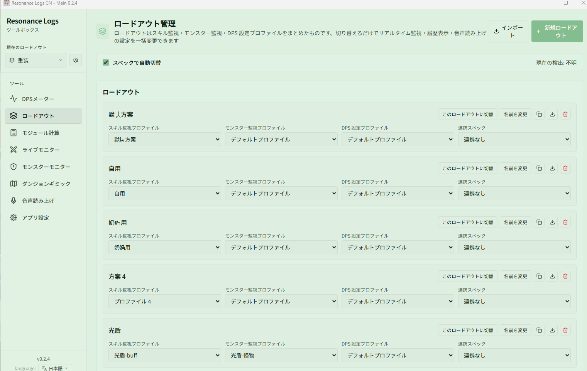
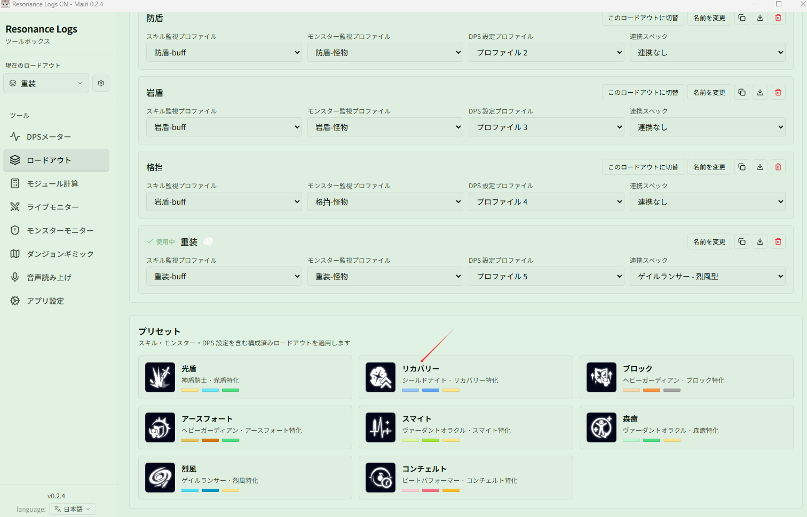
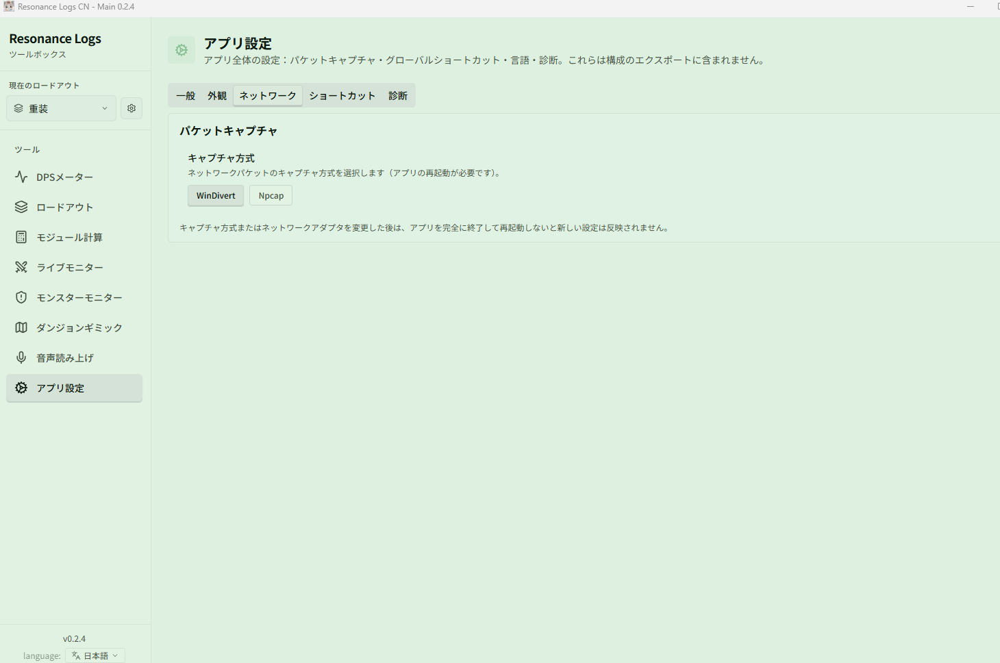

# クイックスタート

このページに沿って進めれば、インストールから最初の戦闘データが表示されるまで約 5 分です。

## 1. アプリをインストール

[ダウンロードページ](https://github.com/fudiyangjin/resonance-logs-cn/releases/latest) から最新の Windows x64 インストーラーを入手してインストールします。

- アップグレード時はそのまま上書きインストールすれば OK です。**ユーザー設定ディレクトリは削除しないでください**。ロードアウト、テーマ、履歴はすべて保持されます。
- 以降の新バージョンはアプリ内でワンクリック更新できます。[アップデート、トレイと設定の復元](../features/app/update.md) を参照してください。

初回起動後、画面の言語は **{{ui:routes.tools.appSettings}} → {{ui:appSettings.tabs.general}}** で切り替えられます（简体中文 / English / 日本語）。Buff やスキル名も連動して切り替わるため、ゲームクライアントと同じ言語にすることをおすすめします。

## 2. 初期ロードアウトを選ぶ

初めて開くと **{{ui:loadout.firstRun.title}}** が表示されます。自分のスペックが一覧にある場合（光盾、リカバリー、ブロック、アースフォート、スマイト、森癒、烈風、コンチェルトなど）は、選ぶだけでスキル CD、Buff、モンスターモニター、DPS 設定が一式そろいます。ない場合は **{{ui:loadout.firstRun.skip}}** をクリックし、あとで [ロードアウト](../features/app/loadouts.md) で自分で作成してください。

## 3. パケット取得方法を設定

アプリはゲームのネットワークデータを読み取って戦闘を集計するため、まずキャプチャ方式を選ぶ必要があります。**{{ui:routes.tools.appSettings}} → {{ui:appSettings.tabs.network}}** を開き、どちらかを選びます。

| 方式 | 事前準備 | 向いているケース |
| --- | --- | --- |
| **WinDivert**（まずはこちらを推奨） | 追加インストール不要。アプリを管理者権限で実行 | ほとんどのユーザー |
| **Npcap** | [Npcap](https://npcap.com/) をインストールし、**ネットワークデバイス** で NIC を選択 | WinDivert がセキュリティソフトにブロックされる場合、または NIC を指定したい場合 |

Npcap を使う場合は、実際にゲーム通信が流れているイーサネットまたは Wi-Fi の NIC を選んでください。Loopback、VirtualBox、VMware などの仮想 NIC は選ばないでください。アクセラレーターや VPN を使っている場合は、ゲーム通信が実際にどの NIC を経由しているかを先に確認してください。

> [!WARNING]
> キャプチャ方式や NIC を変更したあとは、アプリを**完全に終了してから再起動**しないと反映されません。メインウィンドウの閉じるボタンは、既定ではシステムトレイに隠れるだけです。画面右下のトレイアイコンを右クリックして **Quit** を選び、もう一度起動してください。

## 4. 最初の戦闘データを確認

1. ゲームを起動し、戦闘できる場所（例：訓練場の木人）に入ります。
2. ダメージを 1 回与えると、画面に **ライブ DPS ウィンドウ** が現れ、自分の名前とダメージが表示されます。
3. ゲームの途中でアプリを起動した場合は、**マップを 1 回切り替えて**（テレポート、ダンジョンへの出入り、チャンネル変更）、ゲームにキャラクターデータ一式を再送させてください。

データが表示されれば準備完了です。表示されない場合は、[データが出ない / パケットを取得できない？](../faq/app-runtime.md#データが出ない--パケットを取得できない) を順番に確認してください。

> [!TIP]
> ゲームは**変化した**データしか送ってきません。スキル CD、キャラクターのステータス、Buff の表示が欠けていると感じたら、まずマップを 1 回切り替えてください。たいていはそれで直ります。

## 5. 次にやること

| やりたいこと | 参照先 |
| --- | --- |
| DPS ウィンドウの見方を知り、戦闘を振り返る | [DPSメーター](../features/dps/README.md) |
| 自分のスキル CD、Buff、ファクターを画面に表示する | [ライブモニター](../features/monitor/README.md) |
| Boss のデバフ、ヘイト、ギミックのカウントダウンを見張る | [モンスターモニター](../features/monster/README.md) |
| ダンジョンで立ち位置や指名の表示を見る | [ダンジョンギミック](../features/minimap/README.md) |
| 重要なイベントを音声で知らせてほしい | [音声読み上げ](../features/voice/README.md) |
| 最適なモジュールの組み合わせを計算する | [モジュール計算](../features/module-calc/README.md) |
| 設定一式を保存 / 切り替え / 共有する | [ロードアウト](../features/app/loadouts.md) |

画面に慣れていない場合は、先に [画面ガイド](./interface.md) を読むか、[例：初めてダンジョンに行く前の準備](./examples/first-dungeon.md) に沿って一通り試してみてください。

## 例

- [初めてダンジョンに行く前の準備](./examples/first-dungeon.md)