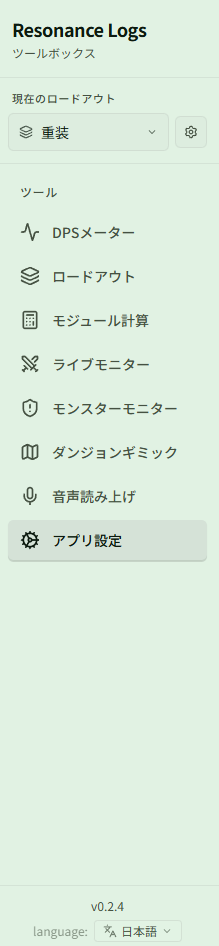
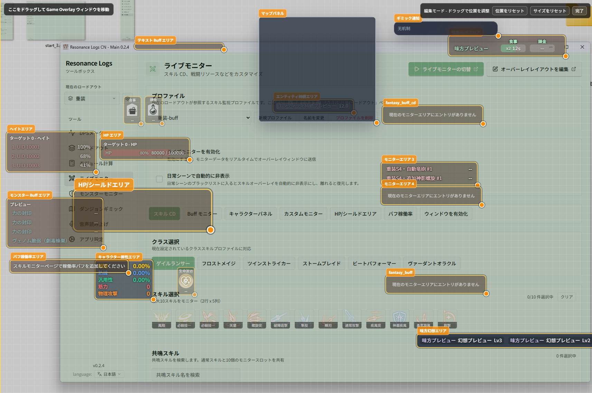

# 画面ガイド

Resonance Logs CN は 1 つの**メインウィンドウ**といくつかの**ゲーム内オーバーレイ**で構成されています。メインウィンドウで設定を行い、オーバーレイがゲーム画面上にデータを表示します。

## メインウィンドウ

左サイドバーには上から順に次の項目があります。

| 項目 | 用途 | ドキュメント |
| --- | --- | --- |
| **{{ui:loadout.sidebar.label}}** | 設定一式（スキル監視 + モンスター監視 + DPS 設定）をワンクリックで切り替え | [ロードアウト](../features/app/loadouts.md) |
| **{{ui:routes.tools.dps}}** | ダメージ / 回復 / 被ダメージのリアルタイム集計、履歴の振り返り、テーマ | [DPSメーター](../features/dps/README.md) |
| **{{ui:routes.tools.loadouts}}** | ロードアウトの新規作成、複製、インポート/エクスポート | [ロードアウト](../features/app/loadouts.md) |
| **{{ui:routes.tools.moduleCalc}}** | 最適なモジュールの組み合わせを計算 | [モジュール計算](../features/module-calc/README.md) |
| **{{ui:routes.tools.skillMonitor}}** | 自分のスキル CD、Buff、ファクター、キャラクターステータスのオーバーレイ | [ライブモニター](../features/monitor/README.md) |
| **{{ui:routes.tools.monsterMonitor}}** | ターゲットの Buff、ヘイト、Boss DBM、エンティティタイマー | [モンスターモニター](../features/monster/README.md) |
| **{{ui:routes.tools.minimap}}** | ダンジョンのミニマップとギミック字幕 | [ダンジョンギミック](../features/minimap/README.md) |
| **{{ui:routes.tools.voice}}** | 音声モデル、音色、短文、読み上げの一覧 | [音声読み上げ](../features/voice/README.md) |
| **{{ui:routes.tools.appSettings}}** | 言語、外観、キャプチャ、ショートカット、診断 | [アプリ設定](../features/app/README.md) |

新しいバージョンがあると、左サイドバーの下部に **更新あり** ボタンが表示されます。[アップデート、トレイと設定の復元](../features/app/update.md) を参照してください。

## ゲーム内オーバーレイ

各オーバーレイはそれぞれ独立した透明ウィンドウで、個別にオン/オフ、移動、拡大縮小ができます。

| オーバーレイ | 表示内容 | オン/オフの場所 |
| --- | --- | --- |
| **ライブ DPS ウィンドウ** | パーティのダメージ / 回復 / 被ダメージ / 死亡リスト | ショートカット、またはトレイの **Show Live Meter** |
| **ライブモニターオーバーレイ** | スキル CD、リソース、キャラクターステータス、カスタムモニターエリア、シールド、稼働率 | {{ui:routes.tools.skillMonitor}} ページ上部 |
| **モンスターオーバーレイ** | 対象の Buff、味方 Buff、ヘイト、スタン、HP、Boss DBM、エンティティタイマー | {{ui:routes.tools.monsterMonitor}} ページ上部 |
| **ダンジョンギミックオーバーレイ** | ミニマップ、ギミック字幕 | {{ui:routes.tools.minimap}} ページ上部 |

> [!TIP]
> オーバーレイ系のウィンドウにはすべて「レイアウト編集」モードがあります。入ると各エリアに枠線が表示され、ドラッグで移動、角のドラッグで拡大縮小できます。編集を終えるとオーバーレイはクリックスルーに戻り、ゲーム操作の邪魔になりません。

## システムトレイ

メインウィンドウの閉じるボタンをクリックしても、既定では**終了せず**、画面右下のトレイに隠れます。トレイアイコンを右クリックすると次の操作ができます。

| メニュー項目 | 動作 |
| --- | --- |
| **Show Settings** | メインウィンドウを再表示 |
| **Show Live Meter** | ライブ DPS ウィンドウを表示 |
| **Reset All Windows** | すべてのウィンドウを既定の位置とサイズに戻す（オーバーレイが画面外に出てしまったときに使用） |
| **Disable Clickthrough** | DPS ウィンドウのクリックスルーを解除 |
| **Quit** | アプリを完全に終了 |

閉じるボタンで直接終了させたい場合は、**{{ui:routes.tools.appSettings}} → {{ui:appSettings.tabs.general}}** で変更できます。[アプリ設定](../features/app/README.md) を参照してください。
