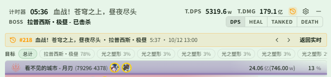
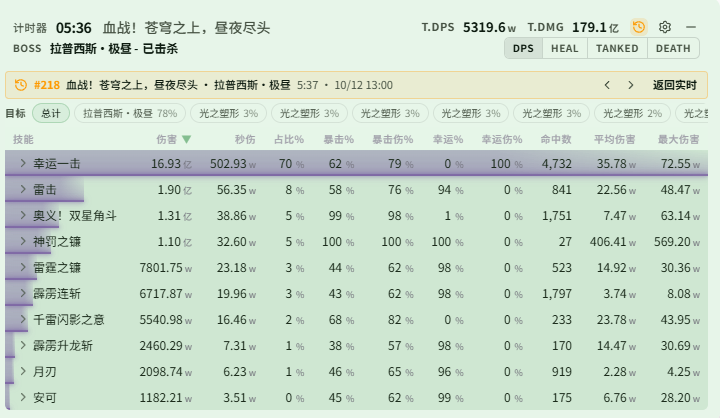

# Changelog v0.2.6

## 更新内容

### DPS / 历史

- 实时窗口可直接查看历史记录：点击标题栏的历史按钮打开历史列表，可按场景 / Boss / 玩家 / UID 搜索，也可快速筛选当前场景、当前 Boss、今天、收藏；选中后 DPS、HEAL、TANKED、DEATH 各页都显示这场战斗的数据，顶部横幅可切换更早 / 更晚一场或返回实时。历史按钮默认隐藏，需开启「显示历史按钮」(DPS检测-主题-实时-标题栏设置)
  - DPS 页和技能页上方的目标栏可切换只看对某个目标的伤害
  - 查看历史时实时开始新战斗，横幅会提示「战斗中」，不会自动切回；查看历史期间隐藏重置、暂停等实时控制按钮

  

  

- 历史记录支持按玩家 UID 搜索(DPS检测-历史-搜索类型选择 UID)：输入 UID 开头几位即可列出候选，并显示该 UID 用过的名字和场次；仅支持本版本之后产生的记录
- 历史搜索的候选项不再截断，较多时点击「显示更多」继续展开

### 遮罩监控相关

- 新增怪物技能(怪物监控-怪物技能)：附近任意怪物释放列表中的技能时，在怪物遮罩中显示技能名，停留设定的秒数后消失，再次释放重新计时；可绑定语音，适合监控没有 DBM 预警的技能
  - 怪物技能区默认不显示，需在 怪物监控-启用窗口 打开
- 怪物监控、实时监控的标签页改为分组显示，已在遮罩中显示的区域在标签上有绿点标记
- 遮罩编辑模式新增「撤销本次修改」：把面板位置、尺寸和遮罩窗口恢复到进入编辑时的状态
- 修复先进副本再打开 logs 时队伍信息不全，导致队友 Buff、队友 CD 无法正常显示的问题

### 语音

- 自定义播报文本改为输入完成（失焦或回车）后再保存，不再把输入过程中的文字生成为短句

### 应用设置

- 新增 Boss 血量上报(应用设置-通用-Boss 血量上报)，默认开启

### 模组计算

- 适配游戏更新后的模组数据，修复模组数值读取不到的问题；更新后需重新登录或换线一次以获取新的模组数据

### 数据

- 更新怪物名称、Buff、怪物技能、场景名称与 DBM 配置数据
- 主要增加 Global 服的 S4 翻译；JP 服进入 S4 时，需要在 Discord 上联系我发送对应配置

## 注意事项

### 兼容性提醒

- 如果之前使用过 0.0.2 或 0.0.3，第一次使用 0.0.4-0.2.6 需要清理 `%LOCALAPPDATA%\resonance-logs-cn` 目录下的 `resonance-logs-cn.db`，再重新启动应用
- 0.2.2, 0.2.1 经历了大量重构，若原有功能出现问题请及时联系我
- 0.2.2 修改了表字段, 老的历史记录报错是正常现象, 新的正常
- 语音播报需单独下载模型；首次生成短句可能耗时较长，生成完成后播放不再加载模型

### 特别注意

- 如果你自己修改了代码又不想提交 PR，在分享给其他人的时候请把应用名、版本号等原版相关信息都改掉，不要带着原仓库的信息，尤其是应用名和版本号
- 关闭按钮现在会隐藏到右下角，可以将隐藏栏的内容拖到右下角显示，避免窗口程序过多时无法快速找到
- 常见问题见使用手册中的 HTML

### 社区

- QQ 群：`1084866292`
- Discord：https://discord.gg/RHeX47wvDU
