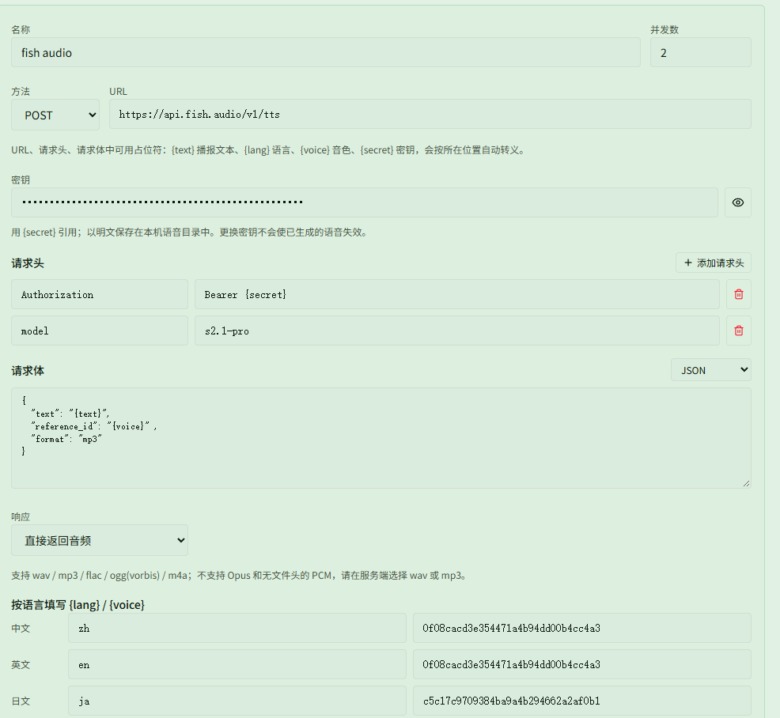

# Changelog v0.2.7

## 更新内容

### 自定义监控

- 重做自定义计数器：可以按技能释放 / 命中、获得或消耗 Buff、移动距离、战斗资源等事件累加，并为每个槽位设置目标值、显示方式、清零动作、暂停和冷却。
- 计数器支持从预设复制、按技能 / 伤害 / Buff 名称或 ID 搜索，保存后可加入自定义监控区，也可以绑定达到目标时的语音播报。
- 因子区和赛季节点区改为自动同步：S4 起可直接显示已激活的赛季节点 Buff；旧版自定义计数器规则会自动迁移清理，相关监控条目和语音绑定也会删除。

### 技能 CD 与技能播报

- 技能 CD 支持多个独立区域，每个区域可单独命名、拖动、缩放，并设置 1～10 行 / 列和图标间距；支持拖拽交换、键盘移动、紧凑排列，布局随方案保存和导入导出。
- 技能选择新增职责技能，按攻击、生存、辅助、图鉴分类；支持职责技能充能，并补充职责技能图标和数据。
- 幻想技能可以单独加入 CD 监控和语音播报；技能、幻想、职责技能共用最多 10 个监控槽位。技能播报不再要求先加入 CD 监控。
- 技能图标增加元素色底板和技能变换显示，明亮场景下更容易辨认；队友 CD 使用相同样式。

### 怪物监控与小地图

- 怪物技能监控支持附近任意怪物释放列表中的技能，而不再局限于特定来源（[@nekoyama32767](https://github.com/nekoyama32767)）；可设置显示时长、顺序、别名和触发语音，怪物技能区默认关闭。
- 小地图解析新的队伍标记信息，被标记的队友会显示对应图标，并增加标记样式和显示设置。
- 补充 S4「苍穹之上，昼夜尽头」部分机制与图标（测试功能）。

### 语音

- 新增 HTTP 语音服务：支持 OpenAI 兼容接口、Google Cloud TTS 和自定义 GET 转发服务，可配置 URL、请求头、请求体、响应格式以及 `{text}`、`{lang}`、`{voice}`、`{secret}` 占位符。
- 添加服务后，还需要在短句批量生成或功能页的播报绑定中选择 HTTP 服务及对应服务；否则仍会使用预置音色。生成前可以测试请求，音频生成后保存在本地，播报时不联网，也不需要安装本地语音模型。

### 模组计算与构建

- 改进 Windows CUDA 构建：区分 MSVC 与 MinGW 的 CMake 缓存，补充 PATH 变化检测，并改善 CMake 错误输出；CUDA 不可用时继续回退 CPU（[@nekoyama32767](https://github.com/nekoyama32767)）。
- 更新模组计算器中的特殊属性字符串处理，避免不同编译器的编码差异。

## 文档

- 补充 HTTP 语音服务的配置示例和使用说明。
- 补充从实时 DPS 窗口打开、筛选和切换历史战斗的说明。
- 更新自定义计数器、技能 CD、职责技能和附近怪物技能的使用文档。

## 注意事项

- 旧版自定义计数器规则升级后会被新计数器系统替代，原规则对应的监控条目和语音绑定不会保留。
- 使用远程 HTTP 语音服务时，短句文本会发送给对应服务；密钥只保存在本机语音目录，不会随方案分享。
- 预置、克隆和微调音色仍需要语音模型；使用 HTTP 语音服务时不需要下载模型。

### 兼容性提醒

- 如果之前使用过 0.0.2 或 0.0.3，第一次使用 0.0.4-0.2.7 需要清理 `%LOCALAPPDATA%\resonance-logs-cn` 目录下的 `resonance-logs-cn.db`，再重新启动应用
- 0.2.2, 0.2.1 经历了大量重构，若原有功能出现问题请及时联系我
- 0.2.2 修改了表字段, 老的历史记录报错是正常现象, 新的正常
- 语音播报需单独下载模型；首次生成短句可能耗时较长，生成完成后播放不再加载模型（HTTP 语音服务不需要模型）

### 特别注意

- 如果你自己修改了代码又不想提交 PR，在分享给其他人的时候请把应用名、版本号等原版相关信息都改掉，不要带着原仓库的信息，尤其是应用名和版本号
- 关闭按钮现在会隐藏到右下角，可以将隐藏栏的内容拖到右下角显示，避免窗口程序过多时无法快速找到
- 常见问题见使用手册中的 HTML

### 社区

- QQ 群：`1084866292`
- Discord：https://discord.gg/RHeX47wvDU
