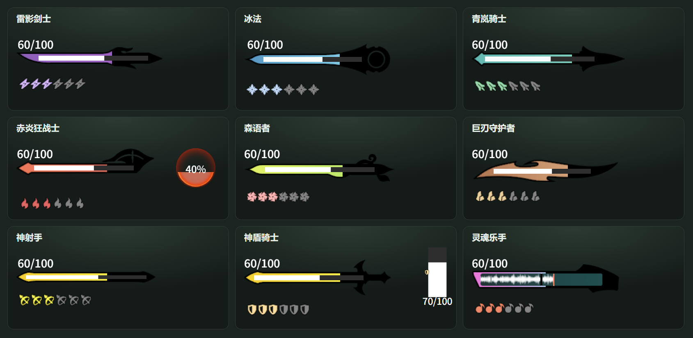
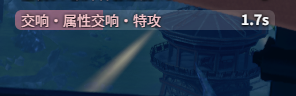
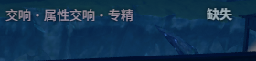
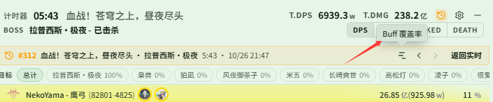
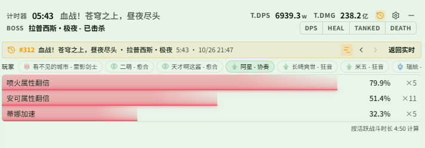
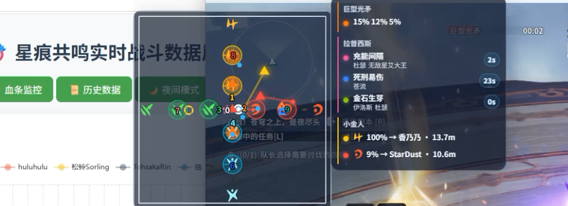

# Changelog v0.2.8

## 更新内容

### 实时监控

- 职业资源栏按游戏内样式重做，补全全部职业(实时监控-启用窗口-资源分区)：资源区拆成资源条、资源点、盾条和职业计数几块，每块都可以单独显示 / 隐藏和拖动
  - 资源条外框上的彩条是职业增益的剩余时间；赤炎狂战士的赤痕球、神射手的狼 / 鹰外框、灵魂乐手的演奏条也在这里
  - 盾条为神盾骑士「光铸身躯」期间的竖向盾条
  - 职业计数还原游戏主界面的层数数字、青岚骑士的风纹、雷影剑士的特殊雷印、赤炎狂战士的评级字母等；原先在 Buff 区随层数变化的图标（如青岚骑士「追击身法」）改到这里显示
  - 新增「资源文字」，调整资源条、资源点和盾条上数字的字号和颜色

  

- 组合 Buff 新增显示方式「最急成员」(实时监控-Buff监控-组合 Buff-显示方式)：任一成员存在时只占一格；有成员缺失时灰显该成员并标「缺失」，否则显示剩余时间最短的成员。适合同时续着几种属性交响这类需要轮流补的 Buff
  - 语音按组合整体的出现、消失和即将结束触发；想单独提醒某个成员，请给该成员自己配置语音
  - 组合不会隐藏成员自己的显示，成员如果还单独加在其他区域，会照常各显示一条

  

  

- 技能层数改为只显示可用层数，并随图标等比缩放，修复队友 CD 图标较小时层数比图标还大的问题；充能中不再显示时间文字。自身技能 CD 和队友 CD 同时生效
- 尝试修复游戏层在主城自动隐藏期间切换方案后，新出现的有图标 Buff 不显示、必须点一次编辑模式才出现的问题（升级 Svelte 框架版本）

### DPS / 历史

- 实时窗口查看历史时，顶部横幅新增「Buff 覆盖率」按钮：在玩家条中选一名玩家，即可看到他在这场战斗中各个 Buff 的覆盖率和触发次数；玩家按自己、治疗、坦克、输出排序
  - 只统计在 实时监控-Buff覆盖率 中添加过的 Buff，添加之后的战斗才会记录
  - 在覆盖率页切换更早 / 更晚一场时停留在覆盖率页；再点一次按钮回到原来的统计页

  

  

### 怪物监控

- 怪物技能新增「倒计时」选项(怪物监控-怪物技能)：开启后把显示秒数当作倒计时，显示剩余秒数和进度条，归零时消失
  - 可用来预告「放出技能 A 后固定若干秒释放技能 B」：把 A 加入列表，别名填 B，显示秒数填两者的间隔
- 怪物技能面板样式新增列间距、数值颜色、进度条颜色和进度条透明度

### 副本机制

- 地图面板和机制报幕的背景浓度可以分别调整(副本机制-小地图机制-面板可见性)，调到 0 时地图只保留线条、机制区域和人物点，报幕只保留文字
- S4「苍穹之上，昼夜尽头」(测试功能)
  - 新增各机制的语音播报，可在 副本机制-小地图机制-机制语音播报 中配置（[@nekoyama32767](https://github.com/nekoyama32767)）
  - 修复老一符文轮盘的符文一直不显示的问题；补充连战机制：轮盘上标出正在点亮的槽位，小金人显示对应符文颜色，机制报幕列出 Boss 的符文点亮顺序和充能间隔
  - 老三天体碰撞：两球改为按球出现的时间预测爆炸位置和时间；三球只画 ①② 站位和路线，并在机制报幕中倒计时第 1 / 2 次爆炸（两光一暗时）

  

  

### 语音

- 功能页中文案为「自动生成」或「自定义文本」的播报，可以用「生成音色」单独指定这一条用哪个音色或 HTTP 服务；「自定义文本」还能用「生成语言」指定按哪种语言生成，并直接点「生成语音」（[@nekoyama32767](https://github.com/nekoyama32767)）
- 「一键生成缺失语音」完成后显示成功和失败条数；生成失败的原因显示在对应的播报下
- 修复本地语音模型偶尔生成短句时停不下来，导致内存 / 显存暴涨的问题：生成长度按文本长度限制，超出时自动重试，最多 3 次
- 尝试修复先打开应用、再切换耳机等播放设备后，语音仍从原设备播放的问题（升级音频播放框架 rodio / cpal 版本）

## 文档

- 新增「用 Fish Audio 在线音色生成播报」示例，并补充按条指定生成音色 / 语言的说明
- 新增「用『最急成员』只看该补的那个属性交响」示例
- 新增「在实时窗口查看历史战斗的 Buff 覆盖率」示例，并在历史记录、Buff 覆盖率页面补充说明
- 更新资源分区（各职业资源条与职业计数示例图）、怪物技能倒计时、副本机制背景浓度的说明

## 注意事项

- 职业计数不再在 Buff 区显示，改为资源区的「职业计数」分区，需要开启资源监控区才会显示；盾条、职业计数等新分区第一次出现时排在资源区原位置的下方，可在编辑模式中拖到合适的位置
- 组合 Buff 的「最急成员」不会隐藏成员自己的显示，只想看一格时，请把这些成员从其他区域删掉

### 兼容性提醒

- 如果之前使用过 0.0.2 或 0.0.3，第一次使用 0.0.4-0.2.8 需要清理 `%LOCALAPPDATA%\resonance-logs-cn` 目录下的 `resonance-logs-cn.db`，再重新启动应用
- 0.2.2, 0.2.1 经历了大量重构，若原有功能出现问题请及时联系我
- 0.2.2 修改了表字段, 老的历史记录报错是正常现象, 新的正常
- 语音播报需单独下载模型；首次生成短句可能耗时较长，生成完成后播放不再加载模型（HTTP 语音服务不需要模型）

### 特别注意

- 如果你自己修改了代码又不想提交 PR，在分享给其他人的时候请把应用名、版本号等原版相关信息都改掉，不要带着原仓库的信息，尤其是应用名和版本号
- 关闭按钮现在会隐藏到右下角，可以将隐藏栏的内容拖到右下角显示，避免窗口程序过多时无法快速找到
- 常见问题见使用手册中的 HTML

### 社区

- QQ 群：`1084866292`
- Discord：https://discord.gg/RHeX47wvDU
