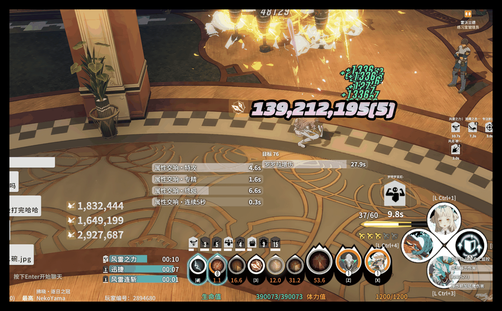
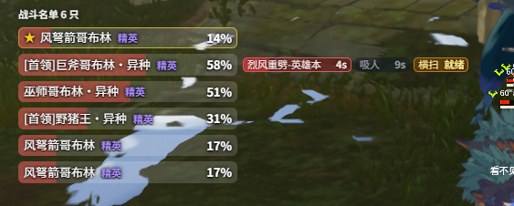
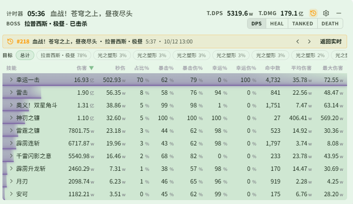

# Changelog v0.2.9

## 更新内容

### 技能伤害显示

- 新增「技能伤害显示」页面(主窗口左侧栏-技能伤害显示)：在游戏层上显示自己指定技能的每次伤害数字（[@nekoyama32767](https://github.com/nekoyama32767)）
  - 技能按技能组管理，每个技能组有独立的显示区域，可在编辑模式中拖动位置；可按技能名称、别名或伤害 ID 搜索添加，同名的不同 ID 可以分别添加
  - 技能标识可选技能名称、技能图标或不显示；预设图标分技能图标和天赋图标，按职业分页，天赋图标再分通用和各专精，另有「公共」分页；可设置图标背景色和不透明度
  - 伤害数字可设置字体（系统字体，或上传 .woff2 / .woff / .ttf / .otf 字体文件）、字号、字重、斜体，以及内侧颜色（纯色 / 渐变）、内发光、轮廓、外发光、阴影；数值格式支持整数、千位分隔、万 / 亿、K / M / B
  - 动画可选弹出或向上浮现并淡出，可设置显示持续时间、逐渐缩小、同时显示数目和后续数字的滚动方向，点「测试动画」即可预览
  - 开启「多次命中合并总伤害」后，同一技能同一批次的多次命中合并显示总伤害，关闭时只显示该批次最大的一次；开启「合并组内同时造成的伤害」后，本组技能同一批次的伤害相加，以组名显示
  - 伤害显示方案跟随配装切换，可在 监控方案 中为每个配装选择「伤害显示子方案」；上传的字体只保存一份，各技能组共用
  - 支持日常场景自动隐藏

  

- DPS 技能明细新增「ID」列，显示技能伤害 ID，方便查到要添加的技能；默认隐藏，可在 DPS检测-设置 中开启

### 怪物监控

- 新增「战斗名单」(怪物监控-战斗名单)：列出你和队友正在交战的所有怪物的血量，在 怪物监控-启用窗口 中打开「战斗名单区」后显示
  - 主目标固定在最上面并标 ★，Boss 全部逐行显示；普通怪和精英按血量逐行显示前几只（默认 5 只），其余合成最后一行小竖条，并标出其中的最高和最低血量，怪再多也不会被藏掉
  - 「坦克模式」：表头统计不在你身上的怪以及它们在打谁，这些怪全部逐行显示，行尾标出目标；也可以开启「不攻击我的怪优先」，让目标是别人的怪排在前面
  - 可显示具体血量和与你的水平距离，方便区分同名的怪
  - 可屏蔽机制标记、场景物件这类不需要关心血量的怪，按怪物 ID 生效，对所有方案和副本都有效；可从「本次遇到的怪物」中点选，也可按名称或 ID 搜索。隐身怪、场地标记等常见机制物已默认屏蔽
- 战斗名单支持「关注技能」：选出你关心的怪物技能，名单会在这只怪那一行的行尾显示技能状态——灰色倒计时为冷却中，琥珀色为就绪，红色为读条中或刚放出
  - 能放关注技能的怪排在主目标下面，始终逐行显示，不占普通怪和精英的逐行名额
  - 冷却默认取游戏表里的数据，也可以自己填写秒数；可从「本次遇到的怪物」中点开一只怪直接勾选技能，旁边会列出冷却、开战首放窗口和读条时长

  

- 实体持续新增调试开关「显示自己放出的所有实体」(怪物监控-实体持续)：开启后实体监控区会在列表条目之后显示你放出的、不在监控列表中的实体，格式为 `名称#ID ×数量`，右侧为已出现的秒数（如 `+12s`），照着填写实体 ID 和持续时间即可；把 ID 加入列表后，这一行直接转为倒计时
- 怪物技能的监控列表上限从 32 条提高到 128 条
- 修复仇恨列表在怪物脱战重置后仍残留旧内容的问题

### 颜色设置

- 所有颜色设置改为「色块 + 色值」一行，可以直接输入 `#38BDF8`、`38bdf8` 或 `rgb(56, 189, 248)`；展开后可选常用色、当前方案用到的颜色和最近使用过的颜色，方便把几处设成完全相同的颜色
- 实时监控、怪物监控页面顶部新增「一键配色」：提供多彩、冰蓝、暖金、翠绿、紫夜、素雅 6 套配色，套用到当前配装的游戏层面板
  - 只改名称、数值和进度条的颜色，字号、间距和背景不变；Buff 告警高亮色和队友 Buff 单列颜色保留
  - 血量、破韧、Boss 预警和战斗名单在所有配色里都保留红、蓝、琥珀这些语义色
  - 各面板的样式设置里也可以只给这一个面板套用某套配色
  - 还有面板是默认白色时，页面顶部会提示，可以直接一键配色，也可以选择不再提示
- DPS检测-主题-预设 新增「推荐样式」：一键套用推荐的配色、表格、标题栏、显示格式、列和历史显示，挑战禁伤保留不变

  

- 全新安装默认使用推荐的 DPS 样式和「多彩」游戏层配色，新建的 DPS 方案也使用推荐样式；预置配装补齐了各面板的配色

### DPS / 历史

- 历史详情的时间轴统一使用设置中的职业色 / 专精色，与表格一致；自己也使用专精色，即时 / 平均曲线靠线型区分；专精相同等颜色相同的玩家会自动错开亮度和色相。历史玩家表也改为按专精色显示
- 历史详情中查看某个玩家的技能、承伤或死亡明细时，可以右键逐层返回；概览页右键不会退回列表
- 历史详情会记住时间轴上选择的队友施法轨道、队友曲线、平均曲线开关、Buff 区的展开 / 分组 / 玩家选择，以及 Buff 覆盖率汇总是否展开；换一场战斗或重启后仍然有效

### 副本机制

- S4「苍穹之上，昼夜尽头」(测试功能)：老一符文轮盘在三环之间画出两条红色分隔圈，普通噩梦和连战都显示

### 游戏数据

- 更新游戏数据表；英文、日文的 Buff、技能、怪物、场景名称优先使用游戏官方文本，减少机翻名称

## 文档

- 新增「战斗名单」说明，包括关注技能、语音播报和屏蔽怪物
- 实体持续补充调试开关「显示自己放出的所有实体」的用法；「显示镰车剩余时间」示例改为先用调试开关读出实体 ID 和持续时间

## 注意事项

- 战斗名单区默认关闭，需要在 怪物监控-启用窗口 中打开；只配置了关注技能语音时，面板关闭也会在后台统计
- 关注技能的语音只播报战斗名单里的怪；没进仇恨列表的机制物不在名单上，这类技能请在 怪物监控-怪物技能 中配置语音
- 关注技能的冷却是「最早可放」的下限，就绪后怪的 AI 不一定马上放；脚本触发的技能（如几只怪同时放）无法预测，只在释放时提醒；读条被打断后实际冷却可能更长
- 「显示自己放出的所有实体」只显示你自己放出的实体，打开开关前已在场的实体从打开时开始计秒；这个开关随方案保存，也会随总方案导出，调好后记得关掉
- 已有的颜色设置不会被自动修改，想换配色请使用「一键配色」或「推荐样式」；两者都会覆盖对应的颜色设置，多个配装共用同一个方案时会一起改变（确认框中会列出这些配装）

### 兼容性提醒

- 如果之前使用过 0.0.2 或 0.0.3，第一次使用 0.0.4-0.2.9 需要清理 `%LOCALAPPDATA%\resonance-logs-cn` 目录下的 `resonance-logs-cn.db`，再重新启动应用
- 0.2.2, 0.2.1 经历了大量重构，若原有功能出现问题请及时联系我
- 0.2.2 修改了表字段, 老的历史记录报错是正常现象, 新的正常
- 语音播报需单独下载模型；首次生成短句可能耗时较长，生成完成后播放不再加载模型（HTTP 语音服务不需要模型）

### 特别注意

- 如果你自己修改了代码又不想提交 PR，在分享给其他人的时候请把应用名、版本号等原版相关信息都改掉，不要带着原仓库的信息，尤其是应用名和版本号
- 关闭按钮现在会隐藏到右下角，可以将隐藏栏的内容拖到右下角显示，避免窗口程序过多时无法快速找到
- 常见问题见使用手册中的 HTML

### 社区

- QQ 群：`1084866292`
- Discord：https://discord.gg/RHeX47wvDU
