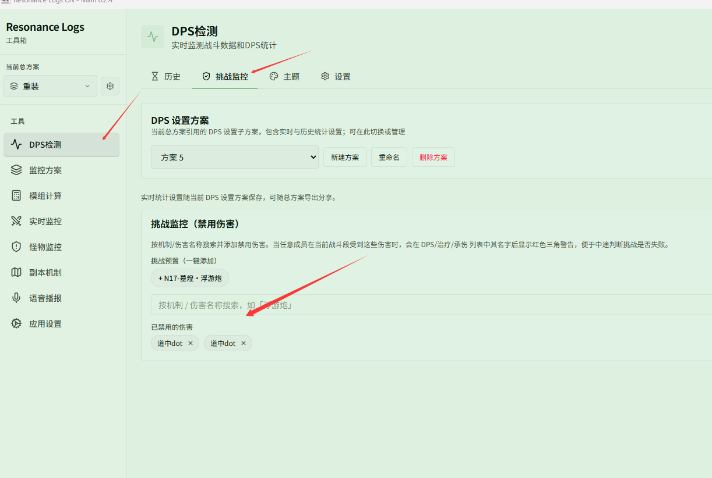

# 挑战监控

**{{ui:routes.tools.dps}} → {{ui:routes.dps.challenge}}** 用来标记「禁用伤害」：只要有队员在当前战斗段中受到这些伤害，他的名字旁就会出现**红色三角**警告。

适合用在「不能被某个机制命中」的挑战目标上，打到一半就能知道挑战是否已经失败。

## 添加禁用伤害

1. 在搜索框中按机制或伤害名称搜索，例如「浮游炮」。
2. 在结果中点击添加，已添加的条目出现在 **{{ui:challengeWatch.configuredTitle}}** 中。
3. 也可以直接使用内置预设 **{{ui:challengeWatch.preset.n17Fuyoupao}}**。

## 在哪里看到警告

红色三角会出现在实时窗口的 DPS、治疗、承伤列表中对应队员的名字后面，鼠标悬停可以看到具体受到的是哪一个伤害。

警告只针对**当前战斗段**，战斗切分或重置后会重新判断。

## 例

- [挑战本中看谁吃了浮游炮](./examples/challenge-hits.md)