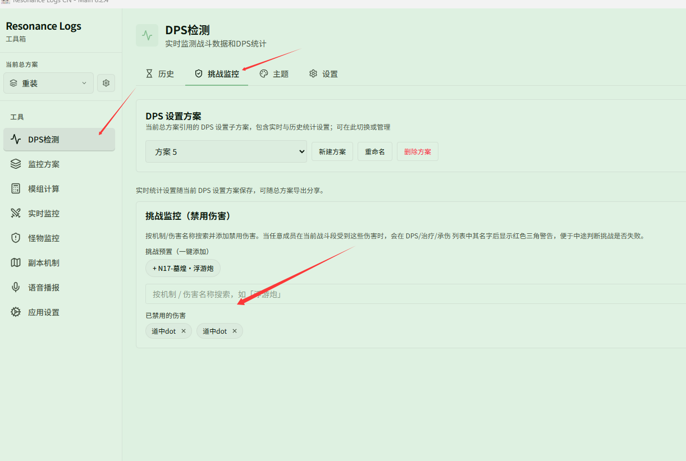

# 挑战监控

**{{ui:routes.tools.dps}} → {{ui:routes.dps.challenge}}** 用来标记「禁用伤害」：只要有队员在当前战斗段中受到这些伤害，他的名字旁就会出现**红色三角**警告。

适合用在「不能被某个机制命中」的挑战目标上，打到一半就能知道挑战是否已经失败。

禁用伤害按**分组**管理，一个挑战一组，跟随当前配装（导出配装时一起带走）。

## 添加禁用伤害

1. 在 **{{ui:challengeWatch.presets.title}}** 中点击内置预设，例如 **{{ui:challengeWatch.preset.n17Fuyoupao}}**，它会作为一个分组加入 **{{ui:challengeWatch.configuredTitle}}**。
2. 也可以点 **{{ui:challengeWatch.group.new}}** 建一个空分组，填上名称，再点 **{{ui:challengeWatch.group.addDamage}}** 搜索：
   - 按机制或伤害名称搜索，例如「浮游炮」；
   - 按伤害 ID 搜索，支持前缀，例如「#110098」（`#` 可省略）；结果很多时点「显示更多」翻页；
   - 输入完整 ID 后按回车，可以直接添加表里没有名称的伤害。
3. 分组里的每个伤害都显示「名称 #ID」，同名的不同伤害也能分清，点 × 移除。



## 我的预设

在分组上点 **{{ui:challengeWatch.group.saveAsPreset}}**，这个分组就会出现在 **{{ui:challengeWatch.presets.mine}}** 中，之后在任何配装里都能一键添加。

- 预设只是模板：添加后得到的是一份独立的分组，之后修改预设不会影响已经添加的分组。
- 修改了一个由「我的预设」添加的分组后，可以点 **{{ui:challengeWatch.group.updatePreset}}** 把改动存回预设。
- 删除「我的预设」不会删除已经添加的分组。

## 在哪里看到警告

红色三角会出现在实时窗口的 DPS、治疗、承伤列表中对应队员的名字后面。鼠标悬停可以看到按分组列出的命中伤害，每一项都带名称、ID 和命中次数，例如：

```
受到禁用伤害
N17-墓煌·浮游炮
· 浮游炮激光直线（诅咒煌墓） #110098140104 ×2
· 浮游炮围射激光 #110098130103 ×1
```


警告只针对**当前战斗段**，战斗切分或重置后会重新判断。

## 例

- [挑战本中看谁吃了浮游炮](./examples/challenge-hits.md)
