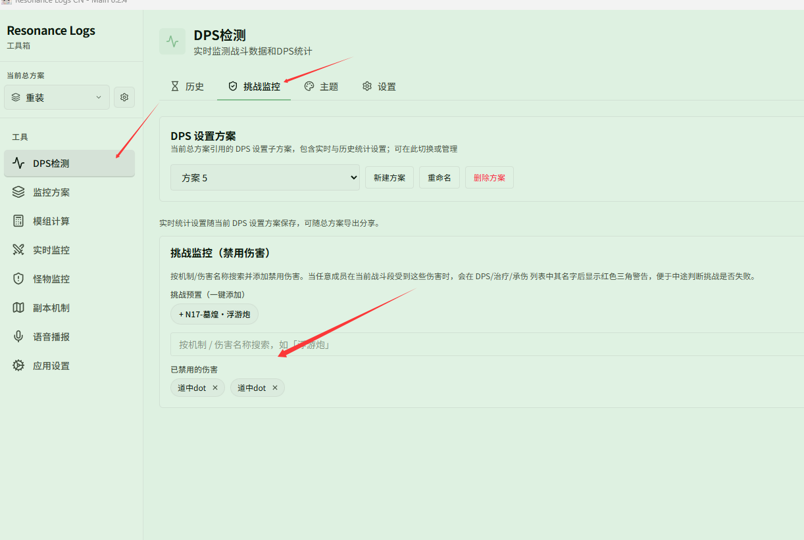

# 挑战本中看谁吃了浮游炮

对应页面：[挑战监控](../challenge.md)

**场景**：打 N17 墓煌时有「不被浮游炮命中」的挑战目标，你希望打到一半就知道挑战是否已经失败，而不是打完才发现。

## 配置

1. 打开 **{{ui:routes.tools.dps}} → {{ui:routes.dps.challenge}}**。
2. 点击预设 **{{ui:challengeWatch.preset.n17Fuyoupao}}**；或者点 **{{ui:challengeWatch.group.new}}**，再在 **{{ui:challengeWatch.group.addDamage}}** 里搜索「浮游炮」或伤害 ID 手动添加。
3. 确认它作为一个分组出现在 **{{ui:challengeWatch.configuredTitle}}** 中。

## 实战

进入战斗后，任何队员一旦被浮游炮命中，实时窗口里他的名字后面就会出现**红色三角**。鼠标悬停可以看到命中的是哪个伤害：名称、ID 和命中次数。

看到红色三角，就可以决定是否直接重开，节省时间。

## 其他挑战

同样的方法适用于任何「不能吃某个机制」的挑战：新建一个分组，按机制、伤害名称或 ID 搜索并添加即可。常用的分组点 **{{ui:challengeWatch.group.saveAsPreset}}**，换配装时也能一键添加。不需要时删除分组，避免在普通战斗中误报。
