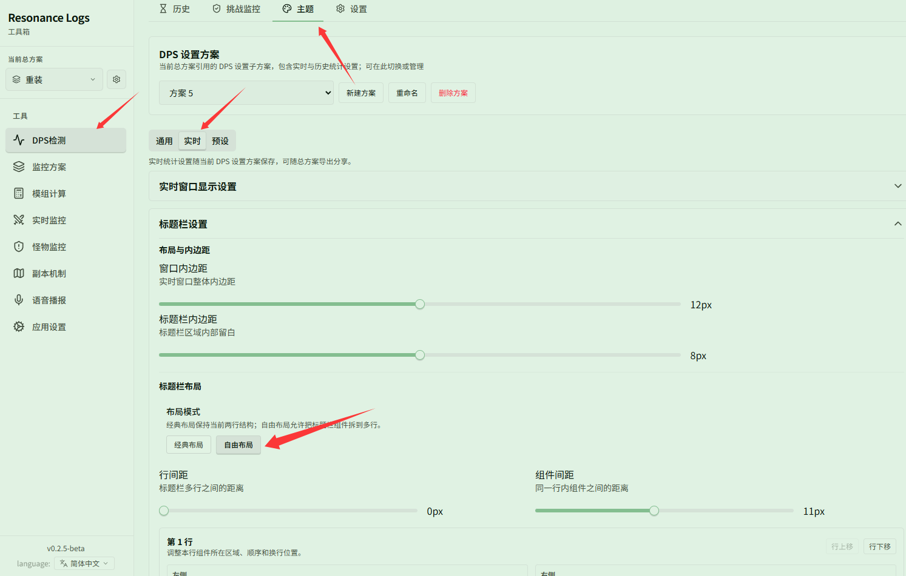
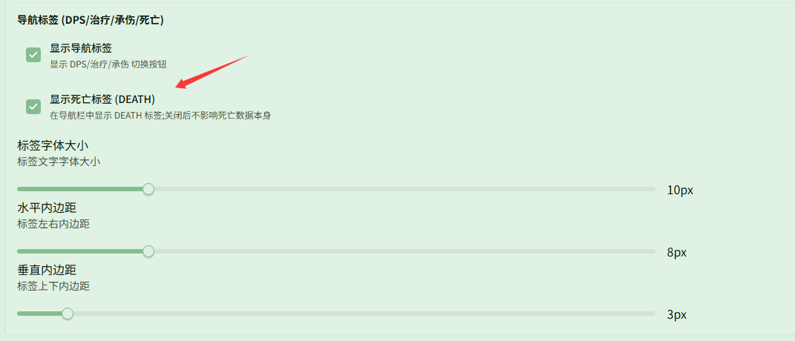

# 标题栏自由布局与死亡回放

对应页面：[主题与外观](../themes.md)

**场景**：你想自定义实时 DPS 窗口标题栏的布局排布，并在战斗中随时切换到 DEATH 标签查看队员的死亡统计与死亡回放。

## 第 1 步：切换为自由布局

在 **{{ui:routes.tools.dps}} → {{ui:routes.dps.themes}} → {{ui:themes.tabs.live}}** 中找到 **{{ui:themes.header.title}}**，在 **{{ui:themes.header.layout}}** 下将 **{{ui:themes.header.layoutMode}}** 切换为 **{{ui:themes.header.layoutMode.custom}}**。

切换为自由布局后，可以将计时器、场景名称、打桩状态、总伤害、总 DPS、Boss 血量、控制按钮、导航标签等组件自由分配到多行，调整左右对齐、排列顺序以及间距。

## 第 2 步：开启死亡标签 (DEATH)

在 **{{ui:themes.header.title}}** 中向下滚动至 **{{ui:themes.header.navigationTabs}}**，勾选 **{{ui:themes.header.showDeathTab}}**。

开启后，实时 DPS 窗口的导航栏中将显示 **DEATH** 标签。在战斗中或团灭后点击该标签，即可直接查看队员死亡次数、总受伤以及致死伤害来源等死亡回放数据。

