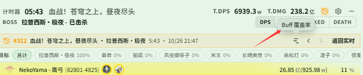
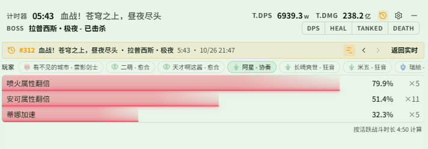

# 在实时窗口查看历史战斗的 Buff 覆盖率

对应页面：[历史记录](../history.md#在实时窗口查看历史)

**场景**：团本刚打完一把，你想马上看看队友这一把的关键增益（例如属性翻倍、蒂娜加速）覆盖了多少，好决定下一把怎么调整轮转。你不想切回主窗口翻历史详情，想直接在实时窗口里看。

## 第 1 步：准备（只需做一次）

1. 打开 **{{ui:routes.tools.skillMonitor}} → {{ui:skillMonitor.tabs.buffCoverage}}**，把要统计的 Buff 加入监听列表，见 [Buff 覆盖率](../../monitor/buff-coverage.md#添加监听)。加入之后的战斗才会记录。
2. 在 **{{ui:routes.tools.dps}} → {{ui:routes.dps.themes}} → {{ui:themes.tabs.live}} → {{ui:themes.header.title}}** 中开启 **{{ui:themes.header.showHistoryButton}}**。

## 第 2 步：打开刚打完的这一场

战斗结束后，点击实时窗口标题栏的历史按钮（悬停提示 **{{ui:live.header.tooltip.history}}**），用 **{{ui:live.history.quick.currentBoss}}** 筛出这个 Boss 的记录，点击最上面的一场。实时窗口顶部会出现历史横幅，显示场景、Boss、时长和结束时间。

## 第 3 步：打开覆盖率页

点击横幅中的覆盖率按钮（悬停提示 **{{ui:live.history.banner.coverage}}**）。

## 第 4 步：选一名玩家看覆盖率

页面顶部是 **{{ui:live.coverage.playersLabel}}** 条，默认选中自己。点击一名队友，下面每行一个 Buff：

- 条的长度和百分比是覆盖率，按**活跃战斗时长**计算，页面右下角注明了这场的活跃时长；Boss 无敌、转场的空档不会拉低数值；
- 右侧的 ×N 是这场触发的次数；
- 鼠标悬停在一行上，可以看到 Buff ID、覆盖时长 / 活跃时长和触发次数。

下图选的是「阿星 - 协奏」。这场活跃时长 4:50，「喷火属性翻倍」覆盖了 79.9%（触发 5 次），「蒂娜加速」只有 32.3%，下一把可以重点留意蒂娜加速的覆盖。

玩家条和各行的排列规则：

- 玩家按自己 → 治疗 → 坦克 → 输出排列，同职业的人挨在一起；这场一个监听 Buff 都没记录到的队友不会出现；
- Buff 按 **{{ui:skillMonitor.tabs.buffCoverage}}** 列表中的顺序排列；这名玩家这场一次都没获得的 Buff 灰显、显示「—」，排在最后；
- 条的颜色跟随所选玩家的职业，玩家名称跟随实时窗口的名称显示设置。

## 第 5 步：和上一把对比

- 用横幅中的 **{{ui:live.history.banner.older}}** / **{{ui:live.history.banner.newer}}** 切换场次。页面会停留在覆盖率页，选中的队友也保持不变；切到的那一场没有这名队友时，显示自己。
- 再点一次覆盖率按钮，回到打开前的统计页（DPS、HEAL 等）；点 **{{ui:live.history.banner.backToLive}}** 回到实时数据。

> [!TIP]
> 想知道覆盖是在哪一段断掉的，打开主窗口历史详情中的 Buff 覆盖时间轴，见 [复盘队伍的增益覆盖率](../../monitor/examples/buff-coverage.md)。

> [!NOTE]
> - 覆盖率页只在查看历史时可用。战斗中想看自己的实时覆盖率，请用实时监控浮窗中的 Buff 覆盖率区。
> - 查看历史期间实时开始了新战斗，横幅会提示 **{{ui:live.history.banner.liveFighting}}**，不会自动切回实时。
