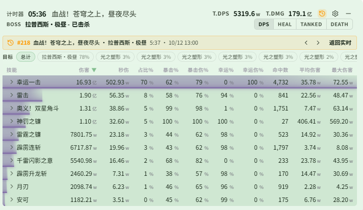

# 一键套用推荐样式

对应页面：[主题与外观](../themes.md)

**场景**：DPS 窗口的配色、列和标题栏改来改去，越改越乱。你想直接用开发者推荐的整套样式，再在此基础上微调；游戏层的各个面板也想一键换成统一的配色。

## 第 1 步：套用推荐样式

1. 打开 **{{ui:routes.tools.dps}} → {{ui:routes.dps.themes}}**，切到 **{{ui:themes.tabs.presets}}**。
2. 点击最上方 **{{ui:themes.presets.reference.title}}** 中的 **{{ui:themes.presets.reference.name}}**。
3. 确认框会说明哪些设置会被覆盖：配色、表格、标题栏、显示格式、列和历史显示。挑战监控的禁用伤害会保留。点击确认。

> [!NOTE]
> 推荐样式写入当前配装的 DPS 设置方案。多个配装共用这个方案时，确认框会列出这些配装，它们会一起改变。

## 效果

实时窗口和历史详情换成推荐的配色、列和标题栏布局：

## 第 2 步：按需微调

在推荐样式的基础上，到 **{{ui:themes.tabs.general}}**、**{{ui:themes.tabs.live}}** 中调整透明度、字号等，或到 [显示设置](../settings.md) 中增减列。想回到推荐样式时，再点一次即可。

## 第 3 步（可选）：游戏层一键配色

**{{ui:routes.tools.skillMonitor}}** 和 **{{ui:routes.tools.monsterMonitor}}** 页面顶部的 **{{ui:hudScheme.open}}** 可以给当前配装的游戏层面板套用一套配色（{{ui:hudScheme.scheme.vivid.name}}、{{ui:hudScheme.scheme.ice.name}}、{{ui:hudScheme.scheme.amber.name}}、{{ui:hudScheme.scheme.jade.name}}、{{ui:hudScheme.scheme.violet.name}}、{{ui:hudScheme.scheme.muted.name}}）。只改名称、数值和进度条的颜色，字号、间距和背景不变；血量、破韧、Boss 预警这些语义色在所有配色里都保留。

> [!TIP]
> 全新安装时，DPS 窗口默认就是推荐样式，游戏层默认使用「{{ui:hudScheme.scheme.vivid.name}}」配色。
