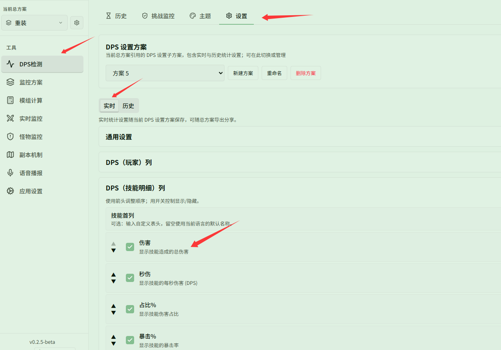
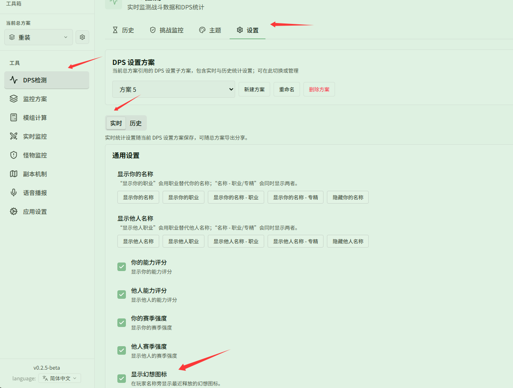
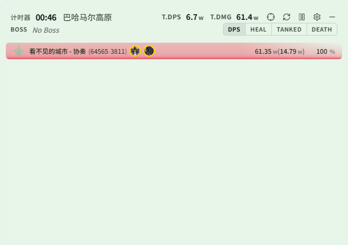

# 修改表格里的展示列

对应页面：[显示设置](../settings.md)

**场景**：你想调整实时 DPS 浮窗或历史记录中技能明细表格展示的数据列（例如只保留伤害、秒伤和暴击率），为列设置个性化的自定义表头，并开启专精、能力评分、赛季强度以及幻想图标等附加信息。

## 第 1 步：定位到对应表格的列配置

打开 **{{ui:routes.tools.dps}} → {{ui:routes.dps.settings}}**。

根据需要调整的窗口选择 **{{ui:settings.tabs.live}}** 或 **{{ui:settings.tabs.history}}** 标签页：
- **实时与历史各自独立**：在 **{{ui:settings.tabs.live}}** 下调整的列配置仅影响实时浮窗；若要修改历史记录详情页里的表格展示列，需切换到 **{{ui:settings.tabs.history}}** 标签页单独调整（仅死亡回放列在实时与历史间共用）。

向下滚动到 **{{ui:settings.common.columns.dpsSkills}}**（或玩家列、治疗列、承伤列等目标表格）：

## 第 2 步：调整开关、顺序与自定义表头

- **显示/隐藏**：点击每列右侧的开关，即可开启或隐藏该列；
- **调整排序**：使用上下箭头调整列在表格中的前后顺序；
- **自定义展示名**：在列右侧的输入框中输入自定义表头文字（留空则自动使用当前语言的默认列名）；如需撤销自定义修改，点击重置图标即可恢复默认名称。

## 第 3 步：配置通用显示信息（专精、评分/强度、幻想图标）

在 **{{ui:settings.tabs.live}}** 标签页顶部的 **{{ui:settings.common.general}}** 中，还可以丰富玩家行展示的信息：
- **名称与专精**：在 **{{ui:settings.common.name.your}}** / **{{ui:settings.common.name.others}}** 中选择「{{ui:settings.common.name.option.yourNameSpec}}」，即可在名字后显示职业专精；
- **能力评分与赛季强度**：勾选 **{{ui:settings.common.ability.your}}**、**{{ui:settings.common.seasonStrength.your}}** 等选项后，玩家名字后会以括号形式显示对应的评分与强度（如 `(64565-3811)`）；
- **显示幻想图标**：勾选 **{{ui:settings.live.fantasyCastIcons}}**，即可在玩家名字旁实时展示最近施放的幻想图标。

## 最终效果

完成设置后，实时 DPS 浮窗将按所选列展示数据，玩家行也会完整显示专精、能力评分、赛季强度以及最近施放的幻想图标：

