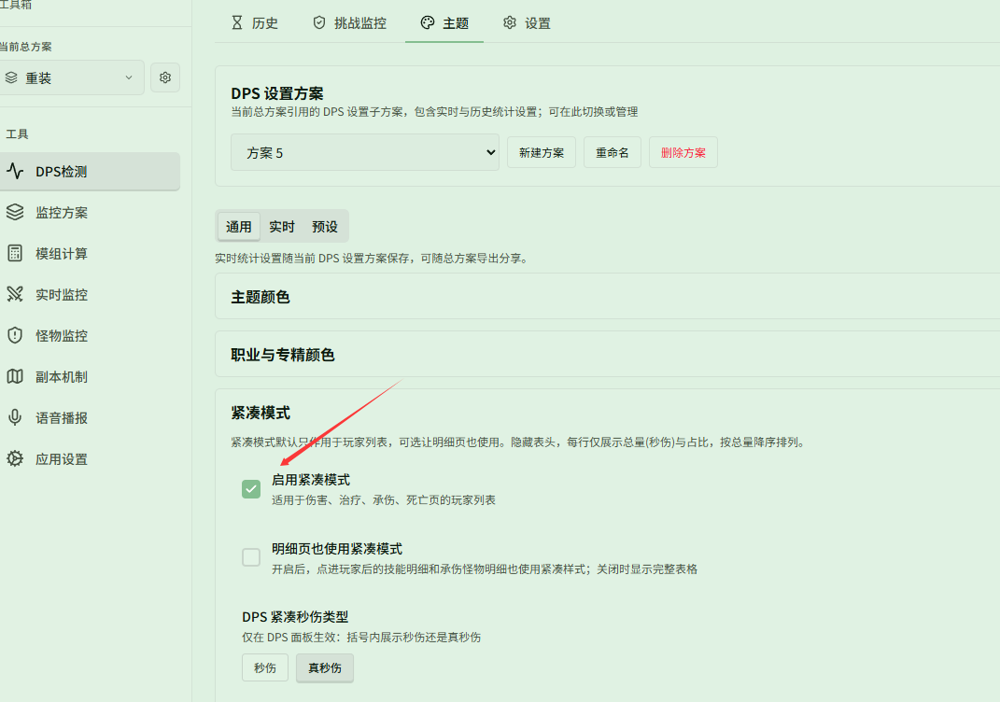
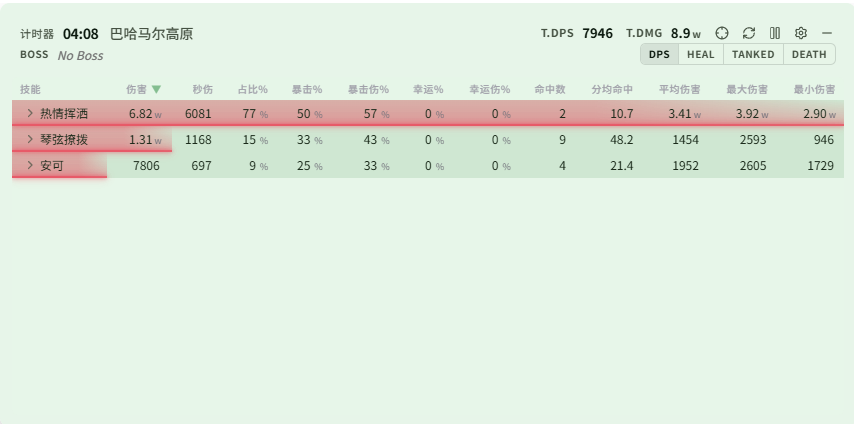
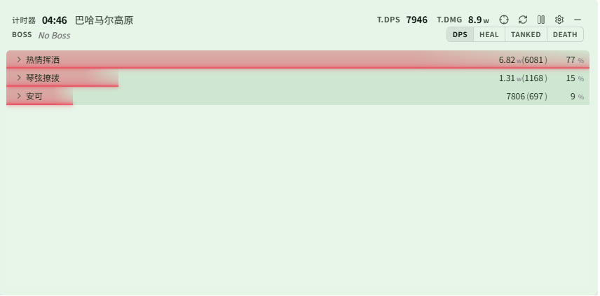

# 透明的极简 DPS 窗口

对应页面：[主题与外观](../themes.md)

**场景**：你只想在屏幕角落看到一个半透明的小窗口，显示每个人的秒伤和占比，不要繁琐的表头，也不要挡住游戏操作。

## 第 1 步：开启紧凑模式

在 **{{ui:routes.tools.dps}} → {{ui:routes.dps.themes}} → {{ui:themes.tabs.general}}** 中找到 **{{ui:themes.compact.title}}**，勾选 **{{ui:themes.compact.enable}}**，括号类型选 **{{ui:themes.compact.option.tdps}}**（或 **{{ui:themes.compact.option.dps}}**）。开启后，玩家列表将隐藏表头，每行仅显示名字、总量（秒伤/真秒伤）和占比。

紧凑模式默认只作用于玩家列表。如果直接点击玩家进入技能明细（或承伤怪物明细），此时依然会展示完整的明细表格：

如果希望技能详情和承伤明细页也保持紧凑样式，可以进一步勾选 **{{ui:themes.compact.includeDetails}}**。开启后，点击进入技能明细后也会以紧凑单行格式展示：

## 第 2 步：让背景变透明

**{{ui:themes.tabs.general}} → {{ui:themes.section.colorThemes}} → {{ui:themes.section.customColorTheme}}**，找到 **背景（实时）**，把透明度调到 30%～50%。

如果文字在亮色场景中看不清，可以适当提高 **{{ui:themes.table.rowGlowOpacity}}**，让彩色条更实。

## 第 3 步：开启点击穿透

**{{ui:themes.tabs.live}} → 实时窗口显示设置 → {{ui:themes.liveDisplay.clickthrough}}**。之后鼠标会直接穿过窗口。

> [!IMPORTANT]
> 开启点击穿透后就无法用鼠标拖动或重置窗口了。建议先在 [应用设置 · 快捷键](../../app/README.md#快捷键) 中绑定「切换点击穿透」和「重置战斗」，需要时用快捷键操作。

## 想恢复原样

在 **{{ui:themes.tabs.general}} → {{ui:themes.compact.title}}** 中取消勾选 **{{ui:themes.compact.enable}}**，并将背景透明度调回；也可以在 **{{ui:themes.tabs.presets}}** 中重新选择预设恢复默认外观。
