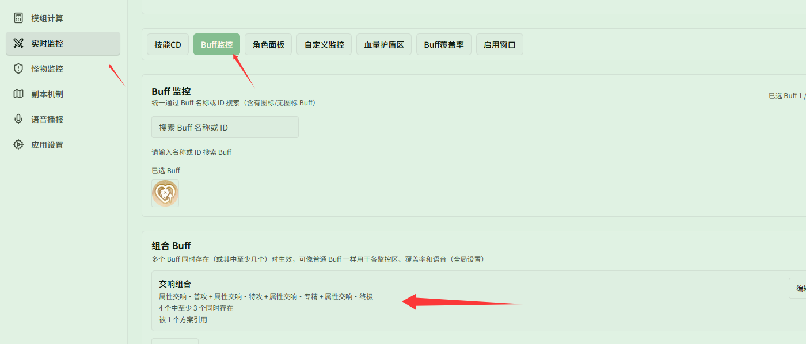
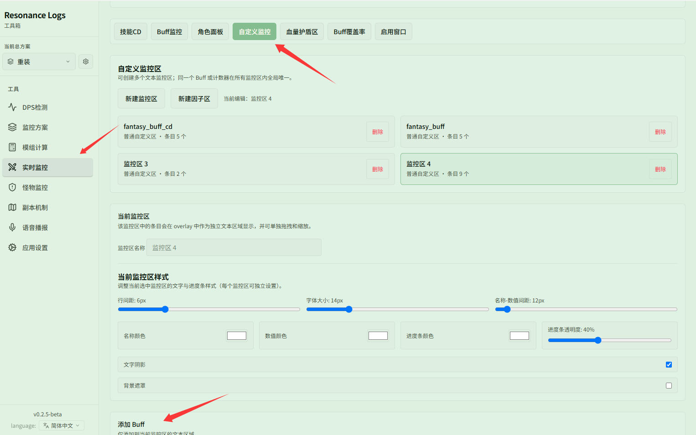

# 用组合 Buff 监控「属性交响」3 层效果

对应页面：[Buff 监控](../buff.md)

**场景**：有些特殊机制需要多个 Buff 同时存在时才触发额外效果，例如「属性交响」存在 3 层时额外提供 20% 伤害。你希望浮窗只在满足 3 层条件时才显示该增益，或者在战斗结束后统计其有效覆盖率。

## 第 1 步：新建组合 Buff

打开 **{{ui:routes.tools.skillMonitor}} → {{ui:skillMonitor.tabs.buff}}**，向下滚动至 **{{ui:skillMonitor.buff.composite.title}}** 区块：

1. 点击 **{{ui:skillMonitor.buff.composite.new}}**；
2. 填写组合名称（如「交响组合」）；
3. 搜索并依次添加 4 个成员 Buff：「属性交响·普攻」、「属性交响·特攻」、「属性交响·专精」、「属性交响·终极」；
4. 将 **{{ui:skillMonitor.buff.composite.condition}}** 设置为「4 个中至少 3 个同时存在」；
5. 点击 **{{ui:skillMonitor.buff.composite.save}}** 保存组合。

## 第 2 步：加入监控区正常监听

保存后的组合 Buff 会被当作一个独立的 Buff，可以像普通 Buff 一样在各功能中使用：

1. 切换到 **{{ui:skillMonitor.tabs.customPanel}}** 标签页，选中一个自定义监控区；
2. 滚动到底部 **{{ui:skillMonitor.customPanel.addBuff}}**，在搜索框中输入「交响组合」（结果中会标注「组合 Buff」），点击加入该监控区；
3. 战斗中当 4 种交响 Buff 至少有 3 个同时存在时，监控区就会自动显示「交响组合」条目及其实时剩余时间和层数。

## 补充：也可以配置在 Buff 覆盖率中

组合 Buff 同样可以加入 **{{ui:skillMonitor.tabs.buffCoverage}}**：
- 在 **{{ui:skillMonitor.tabs.buffCoverage}}** 中搜索并添加「交响组合」；
- 战斗中及历史记录详情中，系统会单独统计「同时维持至少 3 层属性交响」的时长与占比，方便复盘 20% 增伤加成的覆盖质量。
