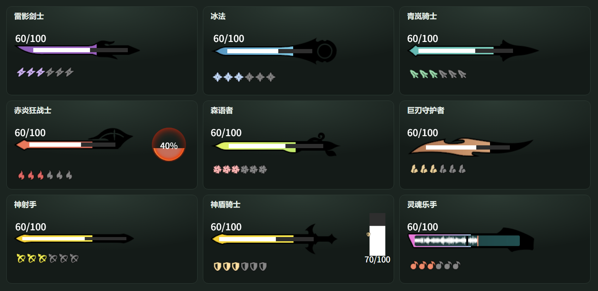
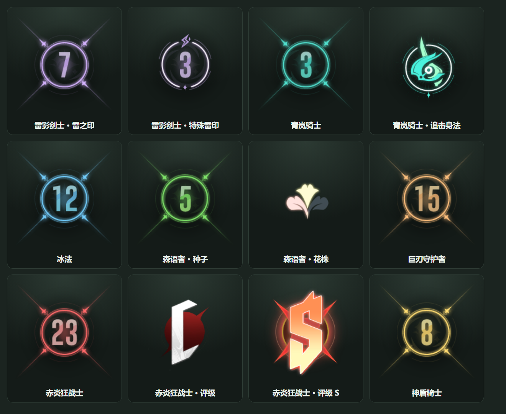
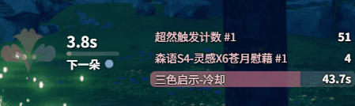

# 用资源分区盯职业资源

对应页面：[启用窗口与布局](../overlay.md)

**场景**：游戏的武器资源条离角色太远，你想把资源条和资源点挪到角色旁边，只留下自己需要的几块。如果你玩森语者愈合专精，还想看清「愈合三花」下一朵什么时候长出来。

## 第 1 步：确认配置职业

资源跟随页面顶部 **{{ui:skillMonitor.profile.title}} → {{ui:skillMonitor.profile.classLabel}}**，不会按你当前登录的角色自动判断。先确认这里是你要用的职业，不对时在这里修改。

> [!NOTE]
> 修改职业会清空当前配置里的监控技能和技能语音，确认框会列出数量；资源布局和其他监控内容不受影响。

## 第 2 步：打开资源监控区

1. 打开 **{{ui:routes.tools.skillMonitor}} → {{ui:skillMonitor.tabs.overlay}}**，打开 **资源监控区**。
2. 下方的 **{{ui:skillMonitor.overlay.resourceSections}}** 列出当前职业的各块资源：资源条、资源点、盾条、职业计数等（赤炎狂战士还有赤痕球）。只保留需要的几块，其余隐藏。

职业计数按游戏主界面的样式显示层数、风纹、评级字母、花株等：

## 第 3 步：摆放位置

1. 点击页面顶部 **{{ui:skillMonitor.layout.editOverlayLayout}}**，每一块资源都可以单独拖动和缩放。
2. 把资源条放在角色脚下，资源点放在旁边；数字太小时，在 **{{ui:skillMonitor.overlay.resourceTextStyle}}** 中调大字号。
3. 完成后退出编辑，浮窗恢复点击穿透。

## 愈合专精：三花倒计时

森语者愈合专精的「愈合三花」是一块单独的资源分区：显示下一朵花株长出来的倒计时（满额 45 秒）和下一朵的颜色。场上没有这个倒计时（例如不是愈合专精）时不显示。

1. 配置职业选 **森语者**，在 **{{ui:skillMonitor.overlay.resourceSections}}** 中只保留三花这一块。
2. 三花倒计时默认不会变色提醒。想在快长出花时高亮，打开 **{{ui:skillMonitor.tabs.buff}} → {{ui:skillMonitor.buff.alert.title}}**，搜索 `2202716`（花株生成倒计时）添加告警，例如剩余 10 秒内变成红色。配置职业是森语者时，这个 Buff 不需要先加入监控就能设置告警。

> [!TIP]
> 预置配装「愈合」已经按上面的方式设置好：只显示三花倒计时，剩余 10 秒内变红。可以在 [监控方案的预置方案](../../app/loadouts.md#预置方案) 中直接添加。
