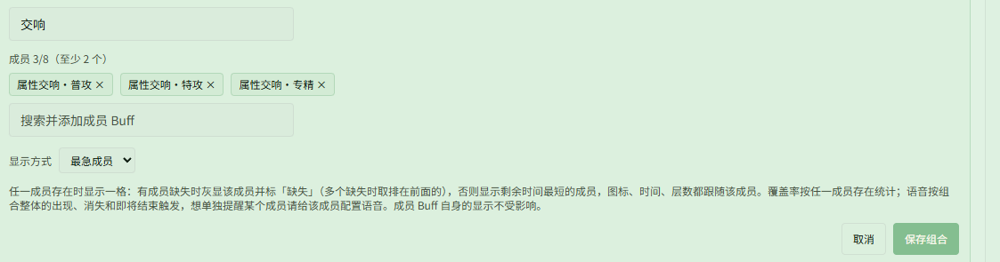
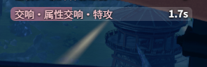
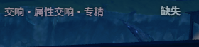

# 用「最急成员」只看该补的那个属性交响

对应页面：[Buff 监控](../buff.md)

**场景**：「属性交响」分普攻、特攻、专精、终极几种，各自单独计时，你需要把其中几种一直续着。如果每种单独监控，屏幕上会同时挂着好几条倒计时，很难一眼看出该补哪个。你希望只看一行：缺了哪个就提示哪个；都在时，显示最快到期的那个。

## 第 1 步：新建「最急成员」组合

打开 **{{ui:routes.tools.skillMonitor}} → {{ui:skillMonitor.tabs.buff}}**，向下滚动至 **{{ui:skillMonitor.buff.composite.title}}** 区块：

1. 点击 **{{ui:skillMonitor.buff.composite.new}}**，填写名称（下图中为「交响」）；
2. 搜索并加入要盯的成员，例如「属性交响·普攻」「属性交响·特攻」「属性交响·专精」，只加你需要维持的几种；
3. **{{ui:skillMonitor.buff.composite.mode}}** 选 **{{ui:skillMonitor.buff.composite.modeMostUrgent}}**；
4. 点击 **{{ui:skillMonitor.buff.composite.save}}**。

> [!TIP]
> 成员按加入顺序排列。同时缺好几个时，显示排在前面的那个，所以把最想先补上的成员先加。

## 第 2 步：加入自定义监控

1. 切换到 **{{ui:skillMonitor.tabs.customPanel}}** 标签页，选中一个自定义监控区；
2. 在底部 **{{ui:skillMonitor.customPanel.addBuff}}** 的搜索框中输入「交响」，结果中会标注「组合 Buff」，点击加入。

也可以直接加到 **{{ui:skillMonitor.tabs.buff}}** 的已选 Buff 中，效果相同。

## 战斗中的效果

成员都在时，这一行显示剩余时间最短的成员，名称为「组合名·成员名」。下图中特攻只剩 1.7 秒，该补特攻了：

有成员不在时，这一行变灰并标「缺失」。下图提示专精断了：

所有成员都不在时，这一行不显示。

## 可选：快断时高亮或语音提醒

- **高亮**：在 **{{ui:skillMonitor.buff.alert.title}}** 中给组合「交响」设阈值，例如 ≤ 2 秒变红。无论当前显示的是哪个成员，它快到期时这一行都会高亮；
- **语音**：组合的语音按整体触发（第一个成员出现、最后一个成员消失、最后一个成员到期前），切换显示的成员时不会播报。想在某个成员快断时单独听到提醒（例如普攻剩 1 秒时播报「普攻」），需要在 **{{ui:skillMonitor.buff.voice.title}}** 中给该成员自己配置。

> [!NOTE]
> **{{ui:skillMonitor.buff.voice.title}}** 只能搜到本方案中有显示的 Buff。成员没有单独显示在任何区域时，在这里搜不到它。

## 常见问题：为什么还是显示了好几行？

组合只占一行，但不会隐藏成员 Buff 自己的显示。如果这些成员还被单独加在其他区域（例如[预置方案](../../app/loadouts.md#预置方案)「重装」的自定义监控里已经列了四种属性交响），它们会照常各显示一行。只想看一行时，把这些成员条目从对应区域删掉即可。

已经给成员配置的语音不受影响，删掉条目后照常播报，只是不会再出现在 Buff 页的 **{{ui:skillMonitor.buff.voice.title}}** 列表中。

## 想统计「同时 3 层」的覆盖率？

最急成员的覆盖率按任一成员存在统计，看不出 3 层效果维持了多久。要复盘 3 层增伤的覆盖率，可以另建一个生效条件为「至少 3 个」的组合，见 [用组合 Buff 监控「属性交响」3 层效果](./attribute-symphony.md)。两个组合可以同时使用。
