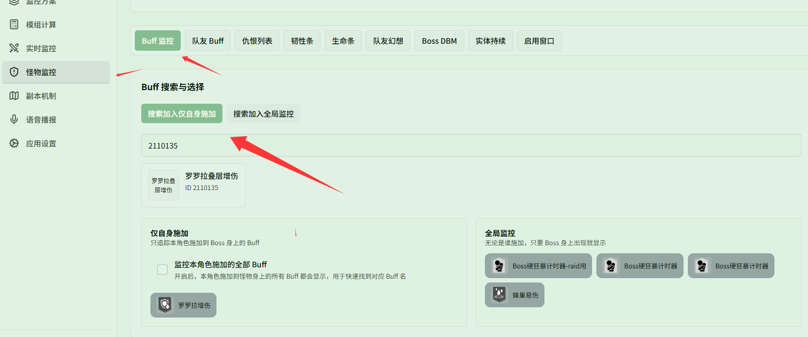

# 监听罗罗拉幻想 Buff 与叠层

对应页面：[目标 Buff](../buff.md)

**场景**：你带了幻想「罗罗拉」，施放后会在 Boss 身上施加基础增伤（罗罗拉增伤）和叠层增伤（罗罗拉叠层增伤）。你希望在浮窗中同时追踪这两项 Buff 的剩余时间与层数，以便把握爆发输出的最佳时机。

## 第 1 步：搜索并添加罗罗拉 Buff 到「仅自身施加」

1. 打开 **{{ui:routes.tools.monsterMonitor}} → {{ui:monsterMonitor.tabs.buff}}**。
2. 保持选中 **{{ui:monsterMonitor.buffSearch.self}}**（仅追踪自己施加的 Buff，避免受队友同名幻想干扰）。
3. 在搜索框中输入 ID `2110111` 或名称搜索 **罗罗拉增伤** 并点击添加。
4. 再次在搜索框中输入 ID `2110135` 或名称搜索 **罗罗拉叠层增伤** 并点击添加。

添加完成后，两项 Buff 均会列在 **{{ui:monsterMonitor.buffGroups.self.title}}** 列表中。

## 第 2 步：调整优先级与告警（可选）

- **优先级**：在 **{{ui:monsterMonitor.priority.title}}** 中将「罗罗拉叠层增伤」移到靠前位置，确保目标身上 Debuff 较多时优先显示层数；
- **告警与语音**：在 **{{ui:monsterMonitor.alert.title}}** 中为「罗罗拉增伤」设置倒计时高亮告警，或在 **{{ui:monsterMonitor.buffVoice.title}}** 中配置失效提醒。
