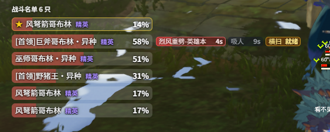

# 拉一群怪时看清全场血量

对应页面：[战斗名单](../roster.md)

**场景**：你是坦克，地下城里一次拉一大群怪。生命条只能看当前目标，你想看到所有交战中怪物的血量，知道哪些怪没在打你、在打谁；精英怪的危险技能快转好时，也想提前知道。

## 第 1 步：打开战斗名单区

1. **{{ui:routes.tools.monsterMonitor}} → {{ui:monsterMonitor.tabs.overlay}}**，打开 **战斗名单区**（默认关闭）。
2. 点击 **{{ui:monsterMonitor.actions.editLayout}}**，把名单拖到屏幕一侧。

## 第 2 步：设置坦克视角

打开 **{{ui:monsterMonitor.tabs.roster}}**：

1. 打开 **{{ui:monsterMonitor.roster.tankMode}}**：表头统计不在你身上的怪以及它们在打谁，这些怪全部逐行显示，行尾标出目标。
2. 打开 **{{ui:monsterMonitor.roster.notAttackingMeFirst}}**，让目标是别人的怪排在前面，优先拉回来。
3. 怪多又同名时，打开 **{{ui:monsterMonitor.roster.showDistance}}**，按距离区分。

## 第 3 步：屏蔽不需要的怪

打完一轮后，在 **{{ui:monsterMonitor.roster.recentTitle}}** 中点击机制标记、场景物件这类不需要看血量的怪，把它们屏蔽。屏蔽按怪物 ID 生效，所有方案和副本通用。

## 第 4 步：关注危险技能

1. 在 **{{ui:monsterMonitor.roster.skills.title}}** 中点击 **{{ui:monsterMonitor.roster.skills.fromRecent}}**，点开刚打过的精英怪，勾选它的危险技能。旁边会列出冷却、开战首放窗口和读条时长。
2. 展开这个技能下面的 **{{ui:monsterMonitor.roster.skills.voiceTitle}}**，打开 **{{ui:voice.binding.event.readyIn}}**，秒数填 3，再勾选 **{{ui:voice.binding.countdown}}**。
3. 打开 **{{ui:routes.tools.voice}} → {{ui:voice.tabs.bindings}}**，点击 **{{ui:voice.bindings.generateMissing}}**。

## 效果

主目标固定在最上面，Boss 和带关注技能的怪逐行显示，其余小怪合成最后一行的小竖条。行尾灰色倒计时是技能冷却，转好前 3 秒听到提醒和倒数。

> [!NOTE]
> 技能冷却是「最早可放」的下限：转好后怪不一定马上放，脚本触发的技能也预测不了。固定周期释放的技能最准。
