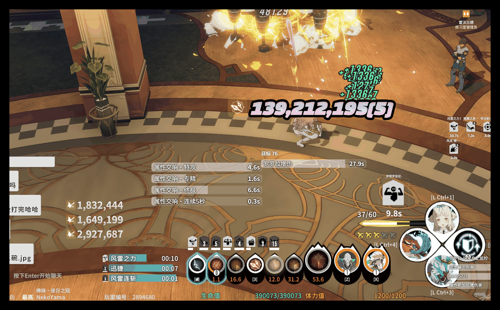

# 技能伤害显示

**{{ui:routes.tools.skillDamage}}** 在游戏层上显示**你自己**指定技能的每次伤害数字。可以给大招、爆发技能单独配一套醒目的字体和动画，也可以把一段时间内的伤害累计成一个总数。

## 开启

1. 打开左侧栏 **{{ui:routes.tools.skillDamage}}**，打开 **{{ui:skillDamage.enabled}}**（默认关闭）。页面顶部的 **{{ui:skillDamage.actions.toggleOverlay}}** 按钮也是同一个开关。
2. 在技能组设置底部搜索并添加技能。默认的技能组是空的，不添加技能就什么也不显示；也可以打开 **{{ui:skillDamage.allSelfDamage}}**，显示自己所有技能的伤害。
3. 点击页面顶部 **{{ui:skillDamage.actions.editLayout}}**，把每个技能组的显示区域拖到合适的位置。

**{{ui:skillDamage.autoHideInDailyScenes.label}}**：进入主城等日常场景时自动隐藏，离开后恢复。

## 方案

伤害显示的设置保存在伤害显示子方案中，跟随 [监控方案](../app/loadouts.md) 切换。页面顶部的 **{{ui:skillDamage.profile.title}}** 可以新建、重命名、删除方案，或给当前配装换一个方案；也可以在 **{{ui:routes.tools.loadouts}}** 页为每个配装选择 **{{ui:loadout.page.damageProfileLabel}}**。上传的字体只保存一份，各方案、各技能组共用。

## 技能组

一个方案里可以有多个技能组，每个组有自己的显示区域、显示模式和数字风格。用 **{{ui:skillDamage.addGroup}}** / **{{ui:skillDamage.deleteGroup}}** 管理，**{{ui:skillDamage.groupEnabled}}** 可以临时关掉某一组。

### 添加技能

在组设置底部的搜索框中按技能名称、别名或伤害 ID 搜索，点击结果添加：

- 同名但 ID 不同的伤害可以分别添加；
- 表里没有名称的伤害，输入完整 ID 也能添加；
- 每个技能可以填写 **{{ui:skillDamage.alias}}**，显示时用别名代替技能名。

伤害 ID 可以在 DPS 技能明细的「ID」列中查看。这一列默认隐藏，在 [显示设置](../dps/settings.md) 中开启。

**{{ui:skillDamage.allSelfDamage}}**：把自己所有技能的伤害都当作本组伤害，不用逐个添加技能，两种显示模式都可以用。

### 显示模式

| 模式 | 效果 |
| --- | --- |
| **{{ui:skillDamage.mergeMode}}**（默认） | 每次命中弹出一个数字 |
| **{{ui:skillDamage.continuousMode}}** | 只显示一条不断累加的伤害，窗口结束后播放总计动画 |

**{{ui:skillDamage.mergeMode}}** 的选项：

- **{{ui:skillDamage.mergeHits}}**：同一技能同一批次的多次命中合并成一个总数；关闭时（默认）逐条显示每次命中。
- **{{ui:skillDamage.groupMerge}}**：同一批次中本组所有技能的伤害相加，以组名显示。
- **{{ui:skillDamage.maxVisible}}**（默认 8）、**{{ui:skillDamage.scrollDirection}}**、**{{ui:skillDamage.animation}}** 和 **{{ui:skillDamage.duration}}**（默认 2.5 秒）。

**{{ui:skillDamage.continuousMode}}** 用 **{{ui:skillDamage.windowMode}}** 决定何时开始累计、何时结算：

| 窗口规则 | 开始累计 | 结算 |
| --- | --- | --- |
| **{{ui:skillDamage.windowRolling}}**（默认） | 组内技能命中 | **{{ui:skillDamage.continuousWindow}}**（默认 1.5 秒）内没有新的命中 |
| **{{ui:skillDamage.windowSkills}}** | 指定的开启技能造成伤害；不指定时组内任意技能命中即开启 | 指定的结束技能命中，或 **{{ui:skillDamage.windowTimeout}}**（默认 15 秒）到时 |
| **{{ui:skillDamage.windowCast}}** | 自己开始施法（目前有寒冰射线和森语者的灌注） | 施法结束，再过 **{{ui:skillDamage.castCloseDelay}}** |

- **{{ui:skillDamage.continuousAll}}**：窗口内其他技能的伤害也计入总数和连击数，但只有组内技能命中才会开启或刷新窗口。
- **{{ui:skillDamage.continuousAnimation}}**、**{{ui:skillDamage.continuousFinalAnimation}}** 分别设置，**{{ui:skillDamage.continuousTotalDuration}}** 控制总计停留多久。
- **{{ui:skillDamage.showComboCount}}**：格式可选 `1 HIT` 或 `×1`，可以放在数字的上、下、左、右。

### 技能标识与数字风格

- **{{ui:skillDamage.labelMode}}**：**{{ui:skillDamage.nameText}}**、**{{ui:skillDamage.nameIcon}}** 或 **{{ui:skillDamage.nameNone}}**。选图标时可以在 **{{ui:skillDamage.iconPresets}}** 中按职业挑选技能图标或天赋图标，并设置 **{{ui:skillDamage.iconBackground}}** 和 **{{ui:skillDamage.iconOpacity}}**。
- **{{ui:skillDamage.format}}**：**{{ui:skillDamage.integer}}**、**{{ui:skillDamage.grouped}}**（默认）、**{{ui:skillDamage.cn}}**、**{{ui:skillDamage.western}}**。
- **{{ui:skillDamage.font}}**：系统字体，或上传 .woff2 / .woff / .ttf / .otf 字体文件；以及 **{{ui:skillDamage.fontSize}}**、**{{ui:skillDamage.fontWeight}}**。
- **{{ui:skillDamage.numberStyle}}**：斜体、**{{ui:skillDamage.fill}}**（纯色 / 渐变）、**{{ui:skillDamage.innerGlow}}**、**{{ui:skillDamage.outline}}**、**{{ui:skillDamage.outerGlow}}**、**{{ui:skillDamage.shadow}}**。
- 调好后点击 **{{ui:skillDamage.test}}**，在页面下方预览当前字体和动画。

> [!NOTE]
> 这里只显示你自己的伤害。DPS 设置中的 [排除目标](../dps/settings.md#排除目标) 不影响这里，打木桩时的伤害数字照常显示。

## 例

- [给大招配醒目的伤害数字](./examples/burst-numbers.md)
- [寒冰射线一次施法的总伤害](./examples/frost-ray-total.md)
