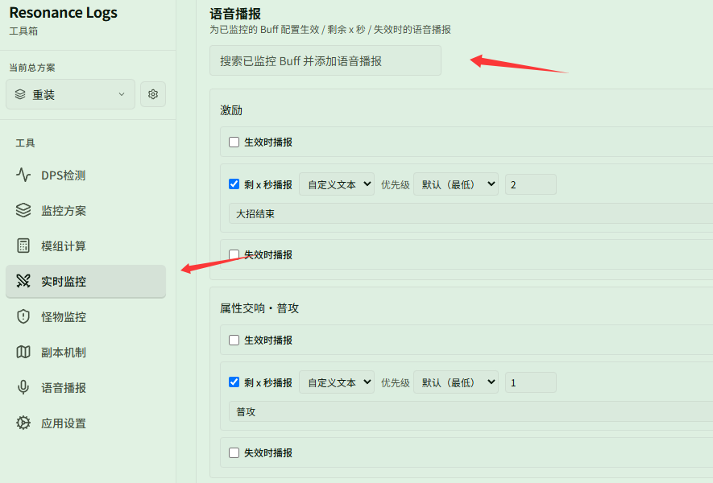
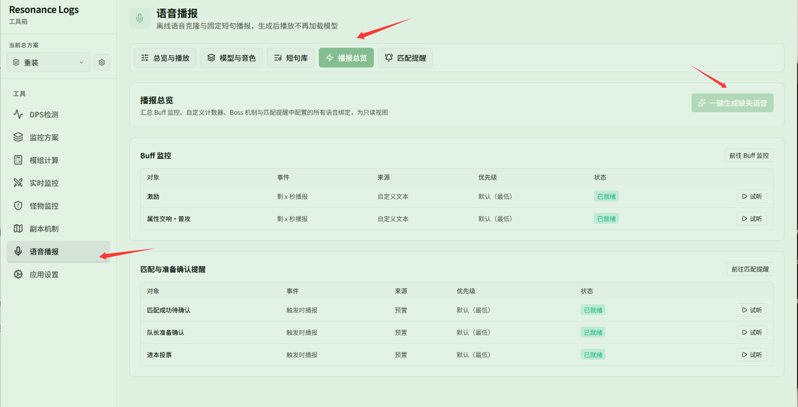

# 为 Buff 设置语音播报并生成

对应页面：[语音播报](../README.md)

**场景**：你希望在自身的某些关键 Buff（例如「激励」或「属性交响·普攻」）即将结束前，听到自定义的语音提醒（如在剩 2 秒时提醒「大招结束」，或在剩 1 秒时提醒「普攻」），并一键完成音频生成。

## 第 1 步：在功能页为 Buff 绑定语音播报

1. 打开 **{{ui:routes.tools.skillMonitor}} → {{ui:skillMonitor.tabs.buff}}**，向下滚动至 **{{ui:skillMonitor.buff.voice.title}}** 区块。
2. 在搜索框中搜索已监控的 Buff（例如「激励」或「属性交响·普攻」），将其添加到语音播报列表中。
3. 勾选 **{{ui:voice.binding.event.expiring}}**，设置提前提醒的时间（如 2 秒或 1 秒）。
4. 文案来源选择 **{{ui:voice.binding.source.custom}}**，输入你想听到的提示词（如「大招结束」或「普攻」）。
5. 优先级保持默认（最低）或按需调整。

## 第 2 步：在播报总览中一键生成语音

新配置或修改自定义文案的播报需要生成离线音频：

1. 打开 **{{ui:routes.tools.voice}} → {{ui:voice.tabs.bindings}}**。
2. 在列表中可以看到刚才配置的条目，状态为待生成。
3. 点击右上角的 **{{ui:voice.bindings.generateMissing}}**，应用将在后台批量生成音频。
4. 生成完成后状态显示为 **{{ui:voice.bindings.status.ready}}**，可以点击右侧的 **{{ui:voice.bindings.tryPlay}}** 试听效果。

