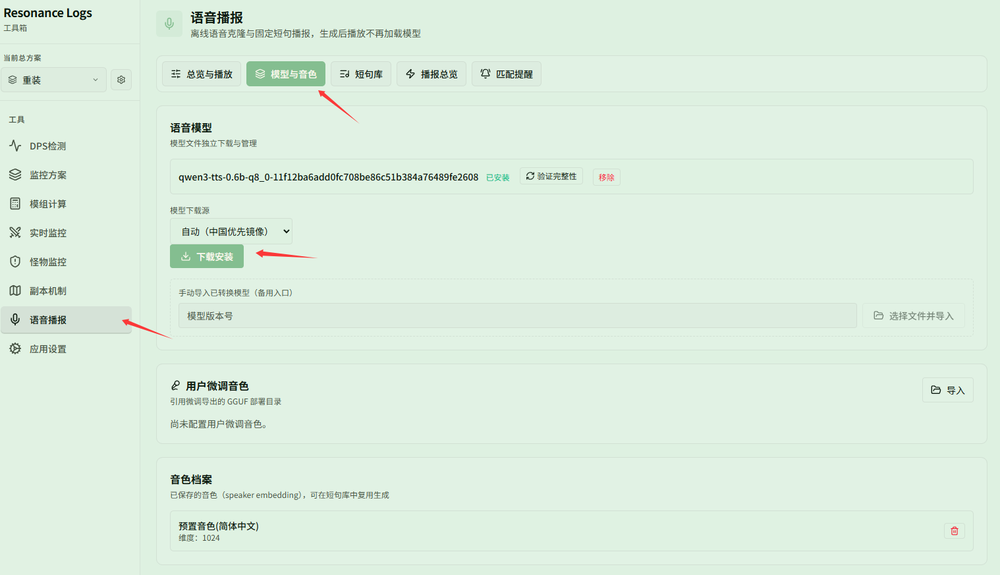
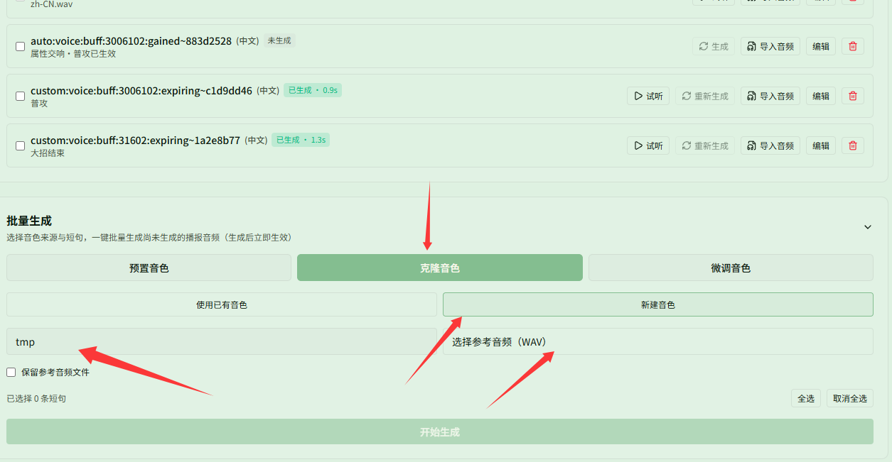
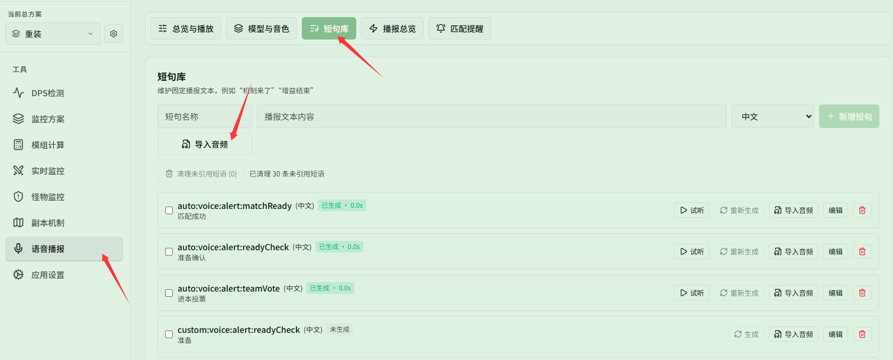

# 下载模型、克隆音色与导入音频短句

对应页面：[音色与短句](../voices.md)

**场景**：你想为语音播报打造个性化的声音体验：安装离线模型后使用默认预置音色或新建克隆专属音色生成播报，或者直接导入现成的音效与录音作为固定短句。

## 第 1 步：下载并安装语音模型

在 **{{ui:routes.tools.voice}} → {{ui:voice.tabs.model}}** 中，确认模型下载源（国内网络默认选择自动优先镜像），点击 **{{ui:voice.model.install}}**。模型下载安装完成后，应用即具备了离线语音克隆与合成能力。

## 第 2 步：新建或选择音色生成播报（预置或克隆）

前往 **{{ui:routes.tools.voice}} → {{ui:voice.tabs.phrases}}**，展开下方的 **{{ui:voice.phrases.generate.title}}** 面板：
- **使用预置音色（默认）**：保持选中 **{{ui:voice.phrases.generate.presetSource}}**，系统会根据当前界面语言自动匹配标准稳定的发音，直接勾选短句即可生成，无需任何准备；
- **新建克隆自己的音色**：切换到 **{{ui:voice.phrases.generate.cloneSource}}**，选择 **{{ui:voice.phrases.generate.createNew}}**，填写 **{{ui:voice.phrases.generate.newProfileName}}**，并点击 **{{ui:voice.phrases.generate.pickReference}}** 选取一段 5～10 秒干净清晰的角色干声（WAV 格式，可按需勾选 **{{ui:voice.phrases.generate.keepReference}}**）；
- 选好音色后，勾选需要生成的短句，点击 **{{ui:voice.phrases.generate.start}}** 进行批量制作。

## 第 3 步：直接导入任意音频作为短句

如果不想使用 TTS 语音合成，或者想直接播放现成的音效、提示音与外部录音：
1. 在 **{{ui:voice.tabs.phrases}}** 顶部的短句管理区中输入 **{{ui:voice.phrases.namePlaceholder}}** 和播报文本内容；
2. 点击 **{{ui:voice.phrases.import.newButton}}**，选择音频文件（支持 wav / mp3 / flac / ogg / m4a，时长 0.2～30 秒）；
3. 导入后状态显示为 **{{ui:voice.phrases.status.imported}}**，导入音频无需模型支持，可直接在各监控功能页中通过 **{{ui:voice.binding.source.phrase}}** 选用。

