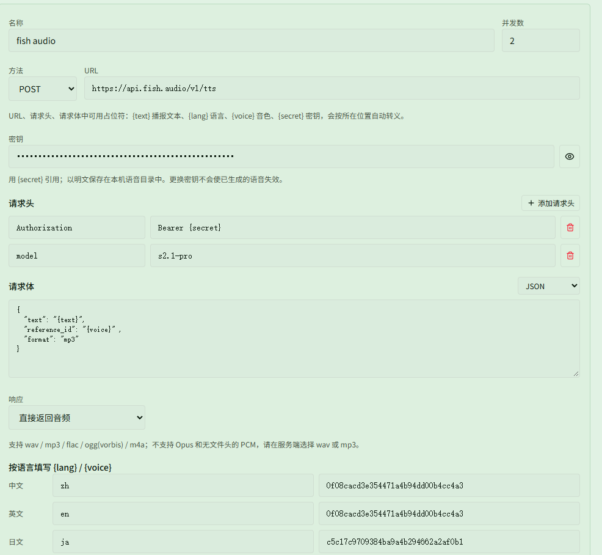

# 用 Fish Audio 在线音色生成播报

对应页面：[音色与短句](../voices.md#方式五http-语音服务)

**场景**：你不想在本机安装语音模型（或者显卡一般，本地生成太慢），想直接用 [Fish Audio](https://fish.audio) 音色库里现成的音色。平时的播报都用一个中文音色，只有「蒂娜好了」这一条想换成日文音色，念日文。

音频只在生成时请求一次，保存到本地后，游戏中播报不联网。使用 HTTP 服务不需要安装语音模型，但仍要在 **{{ui:voice.tabs.overview}}** 中打开 **{{ui:voice.overview.enabled}}**。

## 第 1 步：准备密钥和音色 ID

1. 登录 Fish Audio，在 **API Keys** 页面创建一个密钥并复制下来。API 按用量计费，价格以官网为准。
2. 在音色库中打开想用的中文音色。地址栏形如 `https://fish.audio/m/0f08cacd3e354471a4b94dd00b4cc4a3`，`/m/` 后面这一串就是音色 ID。
3. 用同样的方法再找一个日文音色，记下它的 ID，例如 `c5c17c9709384ba9a4b294662a2af0b1`。

> [!TIP]
> 本例中的两个 ID 只是演示，换成你自己选的音色即可。

## 第 2 步：添加服务

打开 **{{ui:routes.tools.voice}} → {{ui:voice.tabs.model}}**，在 **{{ui:voice.http.title}}** 中选择预设 **{{ui:voice.http.preset.openaiCompatible}}**，点击 **{{ui:voice.http.add}}**。这个预设已经是 POST、JSON 请求体和 `Bearer {secret}` 鉴权，只需要改下面几项：

| 项目 | 填写 |
| --- | --- |
| {{ui:voice.http.form.name}} | `fish audio` |
| {{ui:voice.http.form.concurrency}} | `2`（默认） |
| {{ui:voice.http.form.method}} | POST |
| {{ui:voice.http.form.url}} | `https://api.fish.audio/v1/tts` |
| {{ui:voice.http.form.secret}} | 第 1 步复制的密钥 |
| {{ui:voice.http.form.headers}} | 保留 `Authorization` = `Bearer {secret}`；点 **{{ui:voice.http.form.addHeader}}**，添加 `model` = `s2.1-pro` |
| {{ui:voice.http.form.body}} | 编码选 JSON，内容见下 |
| {{ui:voice.http.form.response}} | **{{ui:voice.http.form.response.audioBytes}}** |

请求体：

```json
{
  "text": "{text}",
  "reference_id": "{voice}",
  "format": "mp3"
}
```

- `{text}` 会替换成短句文本，`{voice}` 替换成下面按语言填写的音色 ID，引号和换行会自动转义。
- `format` 填 `mp3` 或 `wav`。Fish Audio 也能返回 `opus` 和 `pcm`，但应用不支持这两种格式。
- `model` 请求头决定使用哪个模型，可选值以 [Fish Audio 接口文档](https://docs.fish.audio/api-reference/endpoint/openapi-v1/text-to-speech) 为准。

在表单底部按语言填写 `{lang}` 和 `{voice}`：

| 语言 | `{lang}` | `{voice}` |
| --- | --- | --- |
| {{ui:voice.language.zhCN}} | `zh` | `0f08cacd3e354471a4b94dd00b4cc4a3` |
| {{ui:voice.language.enUS}} | `en` | `0f08cacd3e354471a4b94dd00b4cc4a3` |
| {{ui:voice.language.jaJP}} | `ja` | `c5c17c9709384ba9a4b294662a2af0b1` |

这个请求体没有用到 `{lang}`，照填即可。没有专门的英文音色时，英文可以和中文填同一个 ID。



## 第 3 步：试听并保存

1. 在 **{{ui:voice.http.form.test}}** 中选择 **{{ui:voice.language.zhCN}}**，保留默认文本，点击 **{{ui:voice.http.form.testButton}}**。能听到声音，下方显示成功和时长，就说明配置正确。
2. 换成 **{{ui:voice.language.jaJP}}**，输入一句日文（如「ティナ、準備完了」）再试一次，确认用的是日文音色。
3. 点击 **{{ui:voice.http.form.save}}**。

试听失败时，表单下方会显示服务返回的状态码和原因：

| 提示 | 原因 |
| --- | --- |
| `HTTP 401` | 密钥不对，或者 `Authorization` 的值不是 `Bearer {secret}`（`Bearer` 后面有一个空格） |
| `HTTP 402` | Fish Audio 账户余额不足 |
| 其他 `HTTP 4xx` | 音色 ID 或请求体写错，按返回的原因修改 |
| 音频解码失败 | `format` 填成了 `opus` 或 `pcm`，改回 `mp3` |
| 连接失败或超时 | 本机访问不了 `api.fish.audio`，检查网络 |

## 第 4 步：让播报默认使用 Fish Audio

1. 打开 **{{ui:voice.tabs.phrases}}**，在 **{{ui:voice.phrases.generate.title}}** 中选择 **{{ui:voice.phrases.generate.httpSource}}**，再选「fish audio」。
2. 勾选要生成的短句，点击 **{{ui:voice.phrases.generate.start}}**。
3. 这个选择会被记住。之后在 **{{ui:voice.tabs.bindings}}** 点击 **{{ui:voice.bindings.generateMissing}}**，也会用 Fish Audio 生成。

每条短句按自己的语言选用对应一行的音色。界面是中文时，自动生成和自定义文本的播报都是中文短句，所以都会用中文那一行的音色。

## 第 5 步：只给「蒂娜好了」换日文音色

1. 打开 **{{ui:routes.tools.skillMonitor}} → {{ui:skillMonitor.tabs.buff}}**，展开 **{{ui:skillMonitor.buff.voice.title}}**，找到「蒂娜CD」（配置方法见 [蒂娜 CD 转好时语音提醒](../../monitor/examples/tina-cd.md)）。
2. 在 **{{ui:voice.binding.event.lost}}** 中，文案选 **{{ui:voice.binding.source.custom}}**，输入「ティナ、準備完了」。
3. **{{ui:voice.binding.generationSource}}** 选「fish audio」，**{{ui:voice.binding.generationLanguage}}** 选 **{{ui:voice.language.jaJP}}**。
4. 点击 **{{ui:voice.binding.generate}}**，生成后点 **{{ui:voice.binding.tryPlay}}**。

这一条会使用日文那一行的 `{lang}` 和 `{voice}`，其他播报仍然按第 4 步的设置生成。**{{ui:voice.binding.source.auto}}** 的播报也能单独选 **{{ui:voice.binding.generationSource}}**，但只有 **{{ui:voice.binding.source.custom}}** 能改 **{{ui:voice.binding.generationLanguage}}**，所以这里用自定义文本；想改回来时，把 **{{ui:voice.binding.generationSource}}** 选回 **{{ui:voice.binding.generationDefault}}**。

## 注意事项

- 每条短句请求一次。文案中写了 `${阶数}` 时会展开成多条短句（每个阶数一条），请求次数也会相应增加，见 [幻想阶数占位符](../playback.md#幻想阶数占位符)。
- 修改了音色 ID、`model`、请求体或 URL 后，用这个服务生成的音频会显示 **{{ui:voice.phrases.status.stale}}**，需要重新生成。只更换密钥不需要重新生成。
- 批量生成时遇到 `HTTP 401` 或 `HTTP 402` 会立即停止，已经生成好的音频会保留。服务繁忙时返回的 `HTTP 429` / `HTTP 503` 会自动重试；如果经常出现，把 **{{ui:voice.http.form.concurrency}}** 改成 `1`。
- 服务和密钥只保存在本机，不会随 [方案分享](../../app/examples/share-loadout.md) 导出。队友导入方案后，第 5 步那条播报的 **{{ui:voice.binding.generationSource}}** 会显示 **{{ui:voice.binding.generationUnavailable}}**，需要队友自己添加服务后重新选择。
