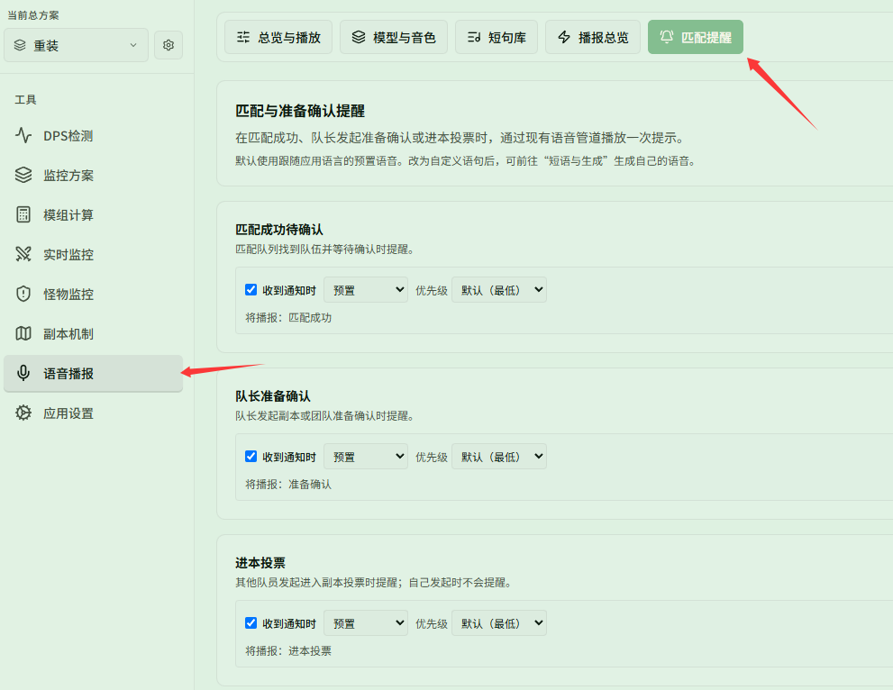

# 挂机排本时听到匹配成功

对应页面：[播放与提醒](../playback.md)

**场景**：你在排本，同时切出去看视频。你希望匹配成功、队长发起准备确认或进本投票时，能听到语音提醒，别错过确认。

## 第 1 步：开启语音

**{{ui:routes.tools.voice}} → {{ui:voice.tabs.overview}}**，打开 **{{ui:voice.overview.enabled}}**，把音量调到切出游戏后也能听清。

## 第 2 步：开启预置语音提醒

打开 **{{ui:voice.tabs.alerts}}**，分别勾选开启：

- **{{ui:voice.alerts.matchReady.title}}**
- **{{ui:voice.alerts.readyCheck.title}}**
- **{{ui:voice.alerts.teamVote.title}}**

**预置语音开箱即用**：应用提前预置了这三项的语音播报，下拉框保持「预置」即可直接使用，无需下载安装语音模型，也无需生成音频。

## 第 3 步：个性化自定义（可选）

如果希望改成更个性化或醒目的提醒（比如「快回来确认」），可将下拉选项切换为「自定义文本」并输入文案。改用自定义文本后，需要前往 **{{ui:voice.tabs.bindings}}** 点击 **{{ui:voice.bindings.generateMissing}}** 生成对应音频。

## 第 4 步：设置优先级

排本提醒一般发生在战斗之外，不会和战斗播报冲突，保持默认（最低）即可。如果你经常在打小怪时排本，可以把它设为 **{{ui:voice.binding.priority.high}}**，避免被其他播报挡住。

> [!NOTE]
> 提醒依赖游戏推送的网络通知，应用必须保持运行（隐藏到托盘也可以）。
