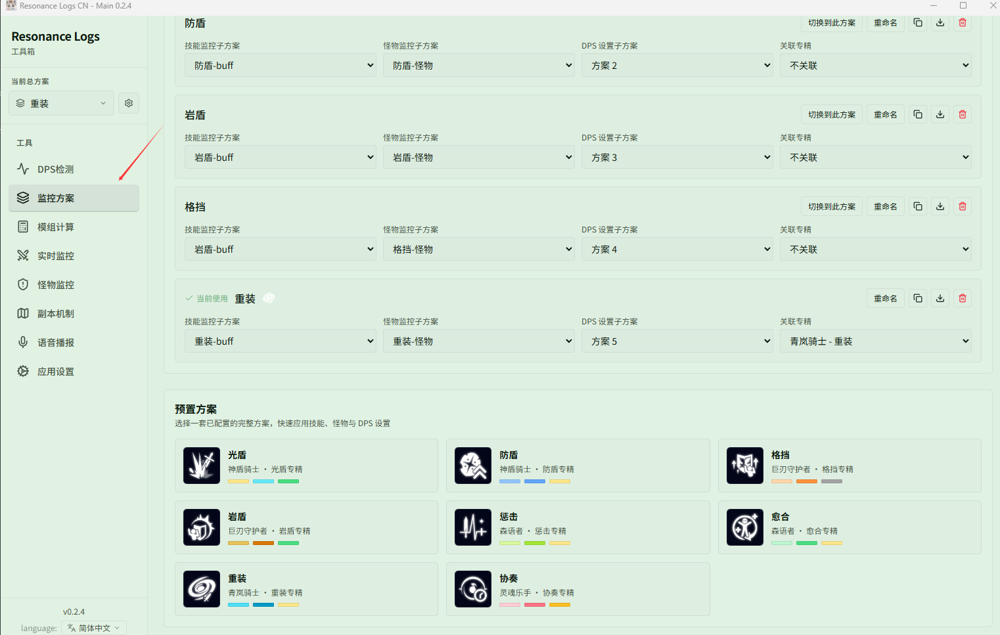
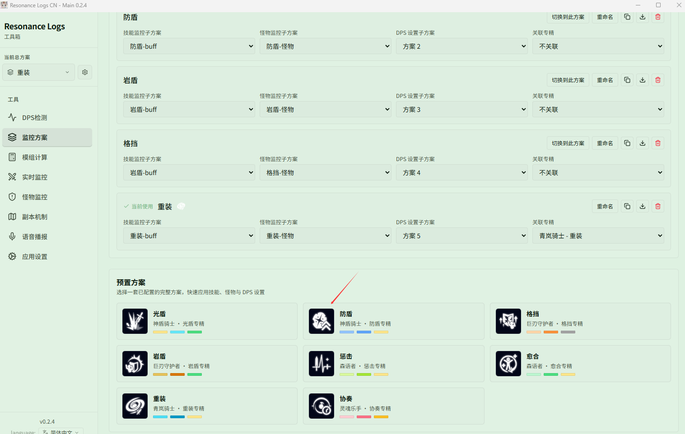
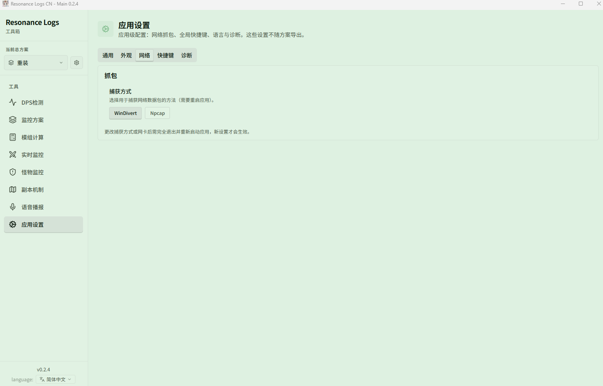

# 快速入门

跟着本页走一遍，大约 5 分钟即可从安装到看到第一条战斗数据。

## 1. 安装应用

从 [下载页](https://github.com/fudiyangjin/resonance-logs-cn/releases/latest) 获取最新的 Windows x64 安装包并安装。

- 升级时直接覆盖安装即可，**不要删除用户设置目录**，你的方案、主题和历史记录都会保留。
- 之后的新版本可以在应用内一键更新，见 [更新、托盘与配置恢复](../features/app/update.md)。

首次启动后，界面语言可在 **{{ui:routes.tools.appSettings}} → {{ui:appSettings.tabs.general}}** 中切换（简体中文 / English / 日本語），建议与游戏客户端保持一致，Buff 与技能名称会随之切换。

## 2. 选择一个初始方案

第一次打开时会弹出 **{{ui:loadout.firstRun.title}}**。如果你的职业专精在列表中（如光盾、防盾、格挡、岩盾、惩击、愈合、重装、协奏），直接选中即可获得一整套配好的技能 CD、Buff、怪物监控与 DPS 设置；否则点 **{{ui:loadout.firstRun.skip}}**，稍后在 [监控方案](../features/app/loadouts.md) 中自行搭建。

## 3. 设置抓包方式

应用通过读取游戏网络数据来统计战斗，需要先选好抓包方式。打开 **{{ui:routes.tools.appSettings}} → {{ui:appSettings.tabs.network}}**，二选一：

| 方式 | 准备工作 | 适合情况 |
| --- | --- | --- |
| **WinDivert**（推荐先试） | 无需额外安装，以管理员权限运行应用 | 大多数用户 |
| **Npcap** | 安装 [Npcap](https://npcap.com/)，并在 **网络设备** 中选择网卡 | WinDivert 被安全软件拦截，或需要指定网卡 |

使用 Npcap 时，请选择真正承载游戏流量的以太网或 Wi-Fi 网卡，不要选 Loopback、VirtualBox、VMware 等虚拟网卡；如果开了加速器或 VPN，先确认游戏流量实际经过哪块网卡。

> [!WARNING]
> 更换抓包方式或网卡后，必须**完全退出并重新启动**应用才会生效。点击主窗口关闭按钮默认只是隐藏到系统托盘，请在右下角托盘图标上右键选择 **Quit** 后再重新打开。

## 4. 验证第一条战斗数据

1. 启动游戏并进入可以战斗的场景（例如训练场木桩）。
2. 打出一次伤害，屏幕上会出现 **实时 DPS 窗口**，显示你的名字和伤害。
3. 如果应用是在游戏中途才打开的，**切换一次场景**（传送、进出副本或换线），让游戏重新下发完整的角色数据。

看到数据就说明一切就绪。如果没有数据，按 [没有数据 / 抓不到包怎么办？](../faq/app-runtime.md#没有数据--抓不到包怎么办) 逐项排查。

> [!TIP]
> 游戏只会推送**变化的**数据。任何时候发现技能 CD、角色属性或 Buff 显示不全，先切一次场景，通常就能恢复。

## 5. 接下来做什么

| 我想要… | 去看 |
| --- | --- |
| 看懂 DPS 窗口、复盘一场战斗 | [DPS 检测](../features/dps/README.md) |
| 在屏幕上显示自己的技能 CD、Buff、因子 | [实时监控](../features/monitor/README.md) |
| 盯 Boss 身上的 Debuff、仇恨、机制倒计时 | [怪物监控](../features/monster/README.md) |
| 在副本里看站位与点名提示 | [副本机制](../features/minimap/README.md) |
| 让关键事件用语音提醒我 | [语音播报](../features/voice/README.md) |
| 计算最优模组搭配 | [模组计算](../features/module-calc/README.md) |
| 保存 / 切换 / 分享整套配置 | [监控方案](../features/app/loadouts.md) |

不熟悉界面的话，可以先看 [界面导览](./interface.md)，或者直接跟着 [例：第一次打本前的准备](./examples/first-dungeon.md) 做一遍。

## 例

- [第一次打本前的准备](./examples/first-dungeon.md)