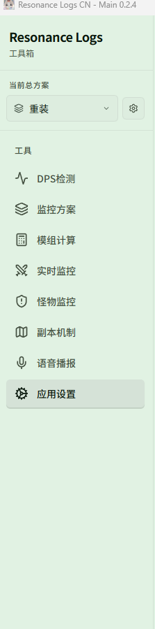
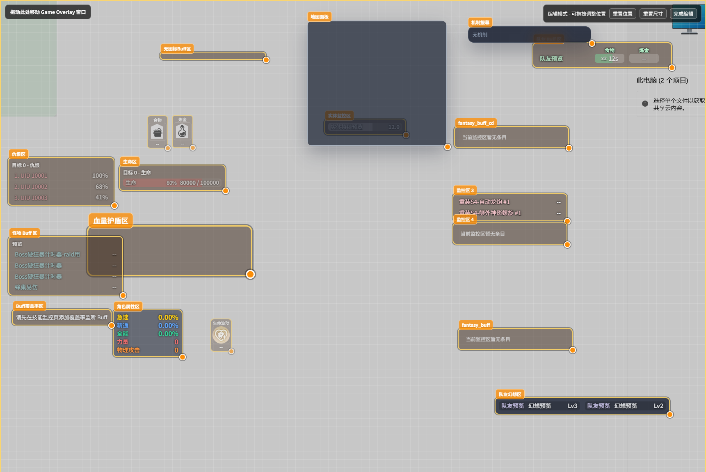

# 界面导览

Resonance Logs CN 由一个**主窗口**和若干**游戏内浮窗**组成：主窗口负责配置，浮窗负责在游戏画面上显示数据。

## 主窗口

左侧栏从上到下依次是：

| 入口 | 用来做什么 | 文档 |
| --- | --- | --- |
| **{{ui:loadout.sidebar.label}}** | 一键切换整套配置（技能监控 + 怪物监控 + DPS 设置） | [监控方案](../features/app/loadouts.md) |
| **{{ui:routes.tools.dps}}** | 实时伤害 / 治疗 / 承伤统计、历史复盘、主题 | [DPS 检测](../features/dps/README.md) |
| **{{ui:routes.tools.loadouts}}** | 新建、复制、导入导出总方案 | [监控方案](../features/app/loadouts.md) |
| **{{ui:routes.tools.moduleCalc}}** | 计算最优模组组合 | [模组计算](../features/module-calc/README.md) |
| **{{ui:routes.tools.skillMonitor}}** | 自己的技能 CD、Buff、因子、角色属性浮窗 | [实时监控](../features/monitor/README.md) |
| **{{ui:routes.tools.monsterMonitor}}** | 目标身上的 Buff、仇恨、Boss DBM、实体计时 | [怪物监控](../features/monster/README.md) |
| **{{ui:routes.tools.minimap}}** | 副本小地图与机制报幕 | [副本机制](../features/minimap/README.md) |
| **{{ui:routes.tools.voice}}** | 语音模型、音色、短句与播报总览 | [语音播报](../features/voice/README.md) |
| **{{ui:routes.tools.appSettings}}** | 语言、外观、抓包、快捷键、诊断 | [应用设置](../features/app/README.md) |

有新版本时，左侧栏底部会出现 **发现新版** 按钮，见 [更新、托盘与配置恢复](../features/app/update.md)。

## 游戏内浮窗

每类浮窗都是独立的透明窗口，可以分别开关、拖动和缩放：

| 浮窗 | 显示内容 | 开关位置 |
| --- | --- | --- |
| **实时 DPS 窗口** | 队伍伤害 / 治疗 / 承伤 / 死亡列表 | 快捷键或托盘 **Show Live Meter** |
| **实时监控遮罩** | 技能 CD、资源、角色属性、自定义监控区、护盾、覆盖率 | {{ui:routes.tools.skillMonitor}} 页顶部 |
| **怪物遮罩** | 目标 Buff、队友 Buff、仇恨、韧性、生命、Boss DBM、实体计时 | {{ui:routes.tools.monsterMonitor}} 页顶部 |
| **副本机制遮罩** | 小地图、机制报幕 | {{ui:routes.tools.minimap}} 页顶部 |

> [!TIP]
> 遮罩类浮窗都有「编辑布局」模式：进入后每个区域会显示边框，可直接拖动位置、拖角缩放；编辑完成后浮窗会恢复点击穿透，不会挡住游戏操作。

## 系统托盘

点击主窗口的关闭按钮默认**不会退出**，而是隐藏到右下角托盘。右键托盘图标可以：

| 菜单项 | 作用 |
| --- | --- |
| **Show Settings** | 重新打开主窗口 |
| **Show Live Meter** | 显示实时 DPS 窗口 |
| **Reset All Windows** | 把所有窗口恢复到默认位置和大小（浮窗跑出屏幕时使用） |
| **Disable Clickthrough** | 关闭 DPS 窗口的点击穿透 |
| **Quit** | 完全退出应用 |

想让关闭按钮直接退出，可在 **{{ui:routes.tools.appSettings}} → {{ui:appSettings.tabs.general}}** 中修改，见 [应用设置](../features/app/README.md)。
